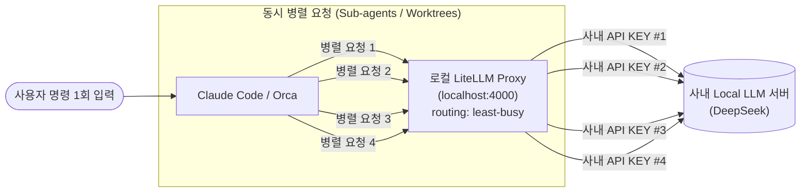

# 사내 Local LLM 다중 API 키 로드밸런싱 및 에이전트 병렬 실행 가이드

사내에 구축된 Local LLM(DeepSeek, Qwen, Llama 등)은 단일 스트림의 토큰 생성 속도(Tokens/sec)가 상용 클라우드 API보다 느리거나, 사내 API 게이트웨이 정책에 따라 **단일 API 키당 동시 요청 수(Concurrency Limit)와 분당 처리량(RPM/TPM)이 제한**되는 경우가 많다.

이때 여러 개의 API 키를 발급받아 **1) 로컬 LiteLLM 프록시로 다중 키 부하 분산(Load Balancing) 계층**을 구성하고, 그 위에 **2) Claude Code 내장 병렬 서브에이전트(Sub-agents)** 또는 **3) Orca(Git Worktree 기반 멀티 에이전트 ADE)**를 결합하면 단일 명령의 전체 대기 시간(Wall-clock Time)을 1/3~1/4 수준으로 줄일 수 있다.

---

## 1. 병렬 호출로 실제 속도가 빨라지는 조건과 도구 선택

다중 API 키로 요청을 동시에 보냈을 때 체감 속도가 빨라지려면 사내 LLM 추론 서버의 동작 방식을 먼저 확인해야 한다.

* **효과가 큰 환경 (vLLM · SGLang · TGI + API 게이트웨이)**:
  * 사내 추론 엔진이 **Continuous Batching(연속 배칭)**을 지원하는 vLLM이나 SGLang으로 구동 중이라면, 단일 요청의 토큰당 지연 시간(ITL)은 GPU 메모리 대역폭 한계로 초당 15~25토큰에 머물더라도 **3~4개의 요청이 동시에 들어올 때 하나의 GPU 연산 배치로 묶여 전체 처리량(Total Throughput)이 2.5~3.5배 증가**한다.
  * 또한 사내 게이트웨이가 API 키 단위로 동시 세션 1~2개 제한을 걸어 둔 경우, 키 4개를 묶어 호출하면 큐 대기 없이 4개 요청이 즉시 병렬 처리된다.
* **주의할 환경 (단일 슬롯 직렬 큐 서버)**:
  * 만약 사내 서버가 `OLLAMA_NUM_PARALLEL=1`처럼 병렬 슬롯을 1개로 막아 둔 단일 프로세스 구조라면 키를 4개 써도 서버 내부 FIFO 큐에서 순차 대기한다. 처음 적용할 때 동시 병렬 수를 **3~4개**로 설정해 개별 응답 시간이 정비례로 늘어나지 않는지 확인한다.

### 병렬 실행 방식별 비교

| 비교 항목 | **LiteLLM 프록시 + Claude Code 서브에이전트** (추천 1순위 ⭐) | **LiteLLM 프록시 + Orca ADE** (추천 2순위 ⭐) | **PowerShell 다중 키 로테이션 함수** (설치 제약 환경) |
| :--- | :--- | :--- | :--- |
| **작업 분할 주체** | **AI가 자동 분할** (내가 명령 1개만 내리면 Claude Code가 `Task` 서브에이전트 3~4개를 동시에 생성) | **사람이 직접 분할** (탭 3~4개를 열어 각각의 기능/버그 작업을 따로 지시) | **사람이 직접 분할** (터미널 창을 4분할해 각각 다른 키로 실행) |
| **다중 키 분배** | LiteLLM이 현재 가장 한가한 키(`least-busy`)로 자동 라우팅 | LiteLLM이 각 Worktree 에이전트 요청을 한가한 키로 자동 라우팅 | 창 번호(`1~4`)에 따라 지정된 API 키를 환경 변수에 바인딩 |
| **파일 충돌 방지** | 메인 에이전트가 읽기/분석 또는 모듈별 담당 파일을 나눠 서브에이전트에 할당 | **Git Worktree 기반 브랜치 격리** + GUI Visual Diff 선별 병합 | 수동으로 작업 대상 폴더를 나누거나 `git worktree` 직접 생성 |
| **가장 적합한 작업** | **하나의 큰 명령**(다수 모듈 동시 분석, 테스트 일괄 작성, 문서 여러 개 동시 요약·생성)의 시간 단축 | **서로 다른 독립 기능 2~4개**(예: A버그 수정, B기능 개발, C문서화)를 동시에 돌려놓고 코드 리뷰 후 병합 | 사내 보안 정책상 Python 프록시나 외부 데스크톱 앱(Orca) 설치가 불가능한 PC |

---

## 2. Step 1: 로컬 LiteLLM 프록시로 다중 API 키 로드밸런서 구축

Claude Code나 Orca는 기본적으로 단일 `ANTHROPIC_API_KEY`만 참조한다. 내 PC 로컬(`http://localhost:4000`)에 **LiteLLM Proxy**를 띄우고 발급받은 사내 API 키 여러 개를 동일한 `model_name` 아래에 등록하면, 에이전트가 동시에 여러 요청을 보낼 때마다 놀고 있는 API 키로 자동 분배된다.



### 1) LiteLLM Proxy 설치

```powershell
pip install "litellm[proxy]"
```

### 2) 다중 키 라우팅 설정 파일 작성 (`litellm_config.yaml`)

동일한 `model_name`(`company-deepseek`)에 발급받은 키 4개를 각각 등록하고 `routing_strategy: least-busy`를 지정한다.

```yaml
model_list:
  - model_name: company-deepseek
    litellm_params:
      model: openai/deepseek-chat           # 사내 서버에 등록된 실제 모델 ID
      api_base: http://internal-llm.company.local/v1
      api_key: "sk-company-issued-key-01"   # 발급받은 키 #1
      max_parallel_requests: 2
  - model_name: company-deepseek
    litellm_params:
      model: openai/deepseek-chat
      api_base: http://internal-llm.company.local/v1
      api_key: "sk-company-issued-key-02"   # 발급받은 키 #2
      max_parallel_requests: 2
  - model_name: company-deepseek
    litellm_params:
      model: openai/deepseek-chat
      api_base: http://internal-llm.company.local/v1
      api_key: "sk-company-issued-key-03"   # 발급받은 키 #3
      max_parallel_requests: 2
  - model_name: company-deepseek
    litellm_params:
      model: openai/deepseek-chat
      api_base: http://internal-llm.company.local/v1
      api_key: "sk-company-issued-key-04"   # 발급받은 키 #4
      max_parallel_requests: 2

router_settings:
  routing_strategy: least-busy              # 현재 진행 중인 요청이 가장 적은 키로 우선 배정
  num_retries: 2                            # 특정 키에서 Rate Limit(429) 발생 시 즉시 다음 키로 재시도
  timeout: 600
```

### 3) 로컬 프록시 기동 및 Claude Code 연결

```powershell
litellm --config litellm_config.yaml --port 4000
```

이어서 `%USERPROFILE%\.claude\settings.json`에서 Claude Code가 로컬 LiteLLM 프록시(`http://localhost:4000`)를 바라보도록 설정한다. LiteLLM은 Anthropic Messages API 엔드포인트(`/v1/messages`)를 자체 지원하므로 OpenAI 규격의 사내 DeepSeek 서버도 Claude Code의 도구 호출(Tool Use)과 그대로 호환된다.

```json
{
  "env": {
    "ANTHROPIC_BASE_URL": "http://localhost:4000",
    "ANTHROPIC_API_KEY": "sk-local-litellm-proxy",
    "API_TIMEOUT_MS": "600000"
  },
  "model": "company-deepseek"
}
```

---

## 3. Step 2: 단일 명령을 병렬로 쪼개 실행하는 2가지 실전 방법

### 방법 A: Claude Code 내장 병렬 서브에이전트(`Task`) 활용 (단일 명령 고속화)

내가 작업을 일일이 나누지 않고 **명령 한 줄만 내렸을 때 AI가 스스로 작업을 3~4개로 쪼개 병렬 실행**하게 만드는 방식이다.

1. 프로젝트 루트(또는 `%USERPROFILE%\.claude\CLAUDE.md`)에 아래 병렬 실행 규칙을 추가한다.

```markdown
# Local LLM 속도 최적화를 위한 병렬 서브에이전트 규칙

- 2개 이상의 독립된 파일·패키지·문서를 분석하거나 생성·수정할 때는 절대 하나의 세션에서 순차적으로 처리하지 않는다.
- 반드시 **한 번의 응답 안에서 3~4개의 Sub-agent(`Task` 도구)를 동시에 병렬 호출**하여 각 에이전트가 담당 파일/모듈을 동시에 처리하게 한다.
- 단, 동일한 파일을 두 서브에이전트가 동시에 수정하지 않도록 서브에이전트별로 담당 파일 경로를 명확히 분리해 지시한다.
```

2. 실제 프롬프트 지시 예시:
   * `"서브에이전트 4개를 동시에 띄워서 auth, order, payment, settlement 4개 모듈의 예외 처리 누락 구간을 병렬로 분석하고 결과를 하나로 합쳐 줘"`
   * `"00_Inbox 폴더에 있는 회의록 4개를 서브에이전트 4개로 동시에 요약해서 01_Projects 폴더에 각각 저장해 줘"`

Claude Code가 한 턴에 4개의 `Task` 서브에이전트를 동시에 실행하면 로컬 LiteLLM이 4개의 HTTP 요청을 각각 `KEY #1` ~ `KEY #4`로 분배하므로, 순차 실행 시 4분 걸리던 작업이 약 1분 만에 완료된다.

---

### 방법 B: Orca ADE를 결합한 멀티 브랜치 병렬 코딩

서로 다른 기능 개발이나 리팩토링 작업 여러 개를 동시에 돌려놓고 싶다면 [Orca](AI_Coding_Agent_Orchestrators_Orca_Paseo.md)를 Step 1의 LiteLLM 프록시와 함께 사용한다.

1. **동작 구조**:
   * Orca에서 새 작업(Task)을 3~4개 생성하면 각 작업마다 독립된 **Git Worktree(별도 작업 폴더와 임시 브랜치)**가 자동으로 만들어지고 그 안에서 Claude Code가 실행된다.
   * 모든 Claude Code 인스턴스는 `%USERPROFILE%\.claude\settings.json`에 설정된 `http://localhost:4000`(LiteLLM)을 바라보므로 별도 설정 없이 4개의 사내 API 키를 자동으로 나눠 쓴다.
2. **활용 시나리오**:
   * **단일 문제 경쟁 모드(Best-of-N)**: 사내 Local LLM 모델의 추론 품질이 아쉬울 때, 동일한 버그 수정 프롬프트를 Orca에서 3개 에이전트에 동시에 던져 병렬로 풀게 한 뒤 가장 깔끔하게 작성된 코드 하나만 선택해 `main`에 병합한다.
   * **다중 기능 동시 개발**: Worktree 1에는 API 구현, Worktree 2에는 단위 테스트 작성, Worktree 3에는 문서 업데이트를 동시에 시켜 두고 완료된 순서대로 Visual Diff를 검토해 병합한다.

---

## 4. 대안: 추가 프로그램 설치가 불가능할 때 (PowerShell 다중 키 + Git Worktree 함수)

사내 보안 정책 때문에 Python(`litellm`)이나 외부 데스크톱 앱(`Orca`)을 설치할 수 없다면, **Windows PowerShell 프로필(`$PROFILE`)**에 아래 스크립트를 등록해 **키 자동 할당 + Git Worktree 격리 실행**을 순수 내장 기능만으로 구현할 수 있다.

```powershell
# notepad $PROFILE 로 열어서 아래 내용 추가

$CompanyApiKeys = @(
    "sk-company-issued-key-01",
    "sk-company-issued-key-02",
    "sk-company-issued-key-03",
    "sk-company-issued-key-04"
)

# 1. 단순 키 번호(1~4) 지정 실행 (동일 폴더 내 분석/질의용)
function cc-key {
    param([int]$Slot = 1)
    $idx = ($Slot - 1) % $CompanyApiKeys.Count
    $env:ANTHROPIC_BASE_URL = "http://internal-llm.company.local/anthropic"
    $env:ANTHROPIC_API_KEY  = $CompanyApiKeys[$idx]
    Write-Host "[Claude Code] Slot #$Slot -> API Key #$($idx + 1) 바인딩 완료" -ForegroundColor Cyan
    claude
}

# 2. Orca 스타일 Git Worktree 격리 + 키 분리 동시 실행 (파일 수정 충돌 방지용)
function cc-parallel {
    param(
        [Parameter(Mandatory=$true)][int]$Slot,
        [Parameter(Mandatory=$true)][string]$TaskName
    )
    $idx = ($Slot - 1) % $CompanyApiKeys.Count
    $branchName = "ai/$TaskName"
    $worktreePath = "../worktree-$TaskName"

    if (-not (Test-Path $worktreePath)) {
        git worktree add -b $branchName $worktreePath
    }

    Push-Location $worktreePath
    try {
        $env:ANTHROPIC_BASE_URL = "http://internal-llm.company.local/anthropic"
        $env:ANTHROPIC_API_KEY  = $CompanyApiKeys[$idx]
        Write-Host "[Worktree: $worktreePath] API Key #$($idx + 1)로 Claude Code를 시작합니다." -ForegroundColor Green
        claude
    } finally {
        Pop-Location
    }
}
```

* **사용 방법**:
  Windows Terminal에서 `Alt + Shift + D`로 화면을 분할한 뒤 각 창에서 아래처럼 실행하면 파일 충돌도 없고 API 키도 서로 겹치지 않는다.

  * 1번 창: `cc-parallel 1 auth-refactor` (`KEY #1` + `../worktree-auth-refactor` 브랜치)
  * 2번 창: `cc-parallel 2 order-test` (`KEY #2` + `../worktree-order-test` 브랜치)
  * 3번 창: `cc-parallel 3 docs-update` (`KEY #3` + `../worktree-docs-update` 브랜치)

---

## 5. 관련 문서

* [Claude CLI - 다중 모델(Multi-Model) 및 DeepSeek 연동 가이드 (Windows)](Claude_CLI_DeepSeek_Setup.md)
* [AI 코딩 에이전트 오케스트레이터: Orca vs Paseo](AI_Coding_Agent_Orchestrators_Orca_Paseo.md)
* [Windows에서 Obsidian과 Claude Code(DeepSeek API) 연동 가이드](Obsidian_Claude_Code_DeepSeek_Guide.md)
