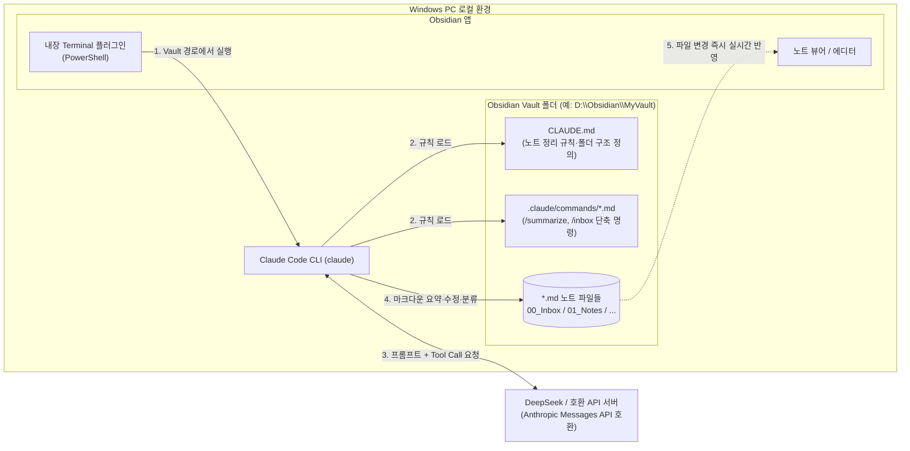

# Windows에서 Obsidian과 Claude Code(DeepSeek API) 연동 및 AI 문서 정리 가이드

Windows PC에 이미 **Obsidian**과 **Claude Code(`claude`)**가 설치되어 있고, Claude 공식 구독 대신 **DeepSeek(또는 호환 API 제공자)의 API 키**를 연결해 사용 중이라면 별도의 유료 서비스를 결제하지 않고도 강력한 **AI 기반 개인 지식 관리(PKM) 및 자동 문서 정리 환경**을 구축할 수 있다.

핵심 원리는 단순하다. **Obsidian의 보관함(Vault)은 결국 Windows 로컬 폴더에 저장된 일반 마크다운(`.md`) 파일들의 모음**이고, **Claude Code는 로컬 폴더의 파일들을 읽고(`Read`), 검색하고(`Grep`), 편집·생성(`Edit`/`Write`)하는 파일시스템 에이전트**다. 따라서 Vault 폴더에서 Claude Code를 실행하면 AI가 노트를 요약·분류·태그 추가·위키링크(`[[링크]]`) 연결한 결과가 Obsidian 화면에 실시간으로 반영된다.

---

## 1. 전체 연동 구조와 사전 점검 (DeepSeek API Tool Calling 확인)

Claude Code가 Obsidian 노트를 직접 읽고 수정하려면 단순 채팅 응답뿐만 아니라 **도구 호출(Tool Use: `Read`, `Edit`, `Write`, `Glob`)**이 정상 동작해야 한다.



### DeepSeek API 연동 시 파일 수정(Tool Use)이 잘 되는지 확인하기

타사 API나 DeepSeek 공식 API를 Claude Code에 연결할 때 **`ANTHROPIC_BASE_URL`이 Anthropic Messages API 규격(Tool Calling 포함)을 지원하는 엔드포인트**여야 Claude Code가 파일을 직접 읽고 고칠 수 있다.

* **DeepSeek 공식 API 직접 사용 시**: 끝이 `/v1`이 아니라 **`https://api.deepseek.com/anthropic`** 엔드포인트를 사용한다.
* **써드파티 프로바이더 / OpenRouter / LiteLLM 사용 시**: 해당 서비스가 제공하는 Anthropic 호환 엔드포인트를 지정한다.
* **Vault 전용 설정 파일(`D:\Obsidian\MyVault\.claude\settings.json`) 예시**:

```json
{
  "env": {
    "ANTHROPIC_BASE_URL": "https://api.deepseek.com/anthropic",
    "ANTHROPIC_API_KEY": "sk-your-deepseek-or-provider-key",
    "API_TIMEOUT_MS": "600000"
  },
  "model": "deepseek-chat",
  "permissions": {
    "allow": [
      "Read(**)",
      "Edit(**/*.md)",
      "Write(**/*.md)",
      "Glob(**)",
      "Grep(**)"
    ]
  }
}
```

> [!TIP]
> 위처럼 Vault 폴더 안의 `.claude/settings.json`에 `"permissions.allow"`로 마크다운(`*.md`) 읽기·쓰기 권한을 미리 허용해 두면, 문서를 요약하거나 정리할 때마다 매번 `[Y/n]` 승인 키를 누르지 않아도 되어 훨씬 쾌적하다. 다중 모델 전환 방법은 [Claude CLI - 다중 모델 및 DeepSeek 연동 가이드](Claude_CLI_DeepSeek_Setup.md)를 참고한다.

---

## 2. 연동 방법 1: Vault 루트에 `CLAUDE.md`를 만들고 터미널에서 연동하기 (필수 기본 설정)

Claude Code는 실행된 폴더에 **`CLAUDE.md`** 파일이 있으면 대화 시작 시 자동으로 읽어들여 시스템 지침으로 삼는다. Obsidian Vault 루트 폴더(예: `D:\Obsidian\MyVault\CLAUDE.md`)에 아래 파일을 만들어 두면, 매번 "한글로 요약해 줘", "위키링크 걸어 줘"라고 설명할 필요가 없다.

### 1) `D:\Obsidian\MyVault\CLAUDE.md` 작성 예시

```markdown
# Obsidian Vault AI 문서 관리 규칙

이 폴더는 나의 Obsidian 개인 지식 보관함(Vault)이다. 모든 노트 작성과 편집은 아래 규칙을 따른다.

## 1. 폴더 구조
- `00_Inbox/`: 임시 메모, 정리되지 않은 스크랩, 회의 날것 메모
- `01_Projects/`: 현재 진행 중인 프로젝트 관련 문서
- `02_Areas/`: 지속적으로 공부하거나 관리하는 기술/업무 영역
- `03_Resources/`: 요약된 기술 가이드, 레퍼런스, 독서/아티클 노트
- `04_Archive/`: 완료되거나 보관 처리된 문서
- `99_Templates/`: 노트 템플릿

## 2. 마크다운 및 Obsidian 문법 규칙
1. **언어**: 모든 요약과 본문 정리는 자연스러운 **한국어**로 작성한다.
2. **YAML Frontmatter 필수 포함**: 모든 노트 최상단에는 아래 형식의 속성(Properties)을 유지하거나 추가한다.
   ```yaml
   ---
   created: YYYY-MM-DD
   tags:

     - 주제태그1
     - 주제태그2
   summary: "핵심 내용 한 줄 요약"
   ---
   ```
3. **내부 링크 연결**: Vault 내에 관련된 기존 노트가 있다면 적극적으로 Obsidian 위키링크(`[[노트제목]]`)로 연결한다.
4. **구조화**: 긴 줄글은 핵심 요약(Callout `> [!summary]`)을 상단에 배치하고, 소제목(`##`, `###`), 글머리 기호, 표(Table)를 활용해 가독성 있게 재구성한다.
5. **원본 보존 원칙**: 사용자가 명시적으로 삭제를 요청하지 않는 한 기존 핵심 사실이나 코드 블록을 임의로 누락시키지 않는다.
```

### 2) 실행 및 기본 사용법

Windows PowerShell을 열고 Obsidian Vault 폴더로 이동한 뒤 `claude`를 실행한다.

```powershell
# 1. 한글 UTF-8 인코딩 깨짐 방지 (PowerShell 프로필에 넣어두면 편리함)
[Console]::OutputEncoding = [System.Text.Encoding]::UTF8

# 2. Obsidian Vault 폴더로 이동 후 Claude Code 실행
cd D:\Obsidian\MyVault
claude
```

실행 후 아래와 같이 자연어로 명령하면 Claude Code가 직접 파일들을 찾아 수정한다.

* `"00_Inbox/회의메모.md 파일을 읽고 핵심 결정사항과 할 일(Action Items)로 요약해서 상단에 정리해 줘"`
* `"Vault 안에서 쿠버네티스 관련 노트들을 모두 찾아서 서로 관련된 부분에 [[위키링크]]를 연결해 줘"`
* `"오늘 클립보드에서 복사해 둔 긴 영문 아티클을 00_Inbox/raw.md에 붙여넣었어. 한국어로 번역·요약해서 03_Resources/ 폴더에 새 노트로 만들어 줘"`

---

## 3. 연동 방법 2: Obsidian 화면 안에 Claude Code 터미널 내장하기 (강력 추천 ⭐)

PowerShell 창과 Obsidian 창을 번갈아 전환(`Alt + Tab`)하는 대신, **Obsidian 우측 사이드바에 터미널을 띄워 놓고 왼쪽에는 노트를, 오른쪽에는 Claude Code를 나란히 보며 작업**하는 구성이다.

### 설정 절차

1. Obsidian 좌측 하단 **설정(⚙️)** → **커뮤니티 플러그인(Community plugins)** → **탐색(Browse)** 클릭
2. **`Terminal`** (작성자: `polyipseity`) 검색 후 **설치(Install)** 및 **활성화(Enable)**
3. `Terminal` 플러그인 옵션에서:
   * **Profiles** → `powershell` (또는 `pwsh`) 프로필을 기본값(Default)으로 설정
4. Obsidian에서 `Ctrl + P` (명령어 팔레트)를 누르고 **`Terminal: Open terminal in new tab`** 실행 후, 생성된 터미널 탭을 마우스로 드래그해 **우측 사이드바 영역**에 고정
5. 내장 터미널은 자동으로 현재 Vault 루트 경로에서 열리므로 곧바로 `claude`를 입력해 실행

이렇게 구성하면 왼쪽 에디터에서 보고 있는 노트를 오른쪽 Claude Code에게 `"지금 열려 있는 00_Inbox/초안.md 파일 깔끔하게 표랑 목차로 다듬어 줘"`라고 지시하고, 파일이 고쳐지는 과정을 왼쪽 화면에서 실시간으로 볼 수 있다.

---

## 4. 연동 방법 3: 자주 쓰는 문서 정리 작업을 슬래시 명령어(`/`)로 등록하기

매번 비슷한 요약·정리 지시를 타이핑하는 대신, Vault 내부의 **`.claude/commands/`** 폴더에 마크다운 파일을 만들어 두면 Claude Code 입력창에서 **`/summarize`**, **`/inbox`**, **`/weekly`** 같은 커스텀 슬래시 명령어로 즉시 실행할 수 있다.

### 1) 단일 노트 요약 및 다듬기 명령어 (`.claude/commands/summarize.md`)

`D:\Obsidian\MyVault\.claude\commands\summarize.md` 파일을 생성하고 아래 내용을 저장한다. (`$ARGUMENTS` 자리에 사용자가 입력한 파일명이나 지시사항이 들어간다.)

```markdown
대상 노트($ARGUMENTS)를 읽고 CLAUDE.md 규칙에 맞춰 다음 순서로 문서를 정리해 줘:

1. 최상단에 YAML Frontmatter(`created`, `tags`, `summary`)를 추가하거나 갱신한다.
2. 본문 시작 부분에 `> [!summary] 핵심 요약` 콜아웃 블록을 만들고 전체 내용을 3~5줄로 요약한다.
3. 뒤죽박죽인 본문 내용을 논리적인 소제목(`##`)과 불릿 리스트, 비교표로 깔끔하게 재구성한다.
4. 단락 끝에 원본 메모에서 빠지면 안 되는 세부 사항이나 코드/명령어는 그대로 유지한다.
5. Vault 내의 다른 노트 제목들을 검색(`Glob`)하여 연결할 만한 관련 노트가 있으면 하단 `## 관련 노트` 섹션에 `[[노트제목]]`으로 링크한다.
```

* **사용법 (Claude Code 프롬프트 창)**:
  ```text
  > /summarize 00_Inbox/네트워크_공부메모.md
  ```

### 2) 인박스(`00_Inbox`) 일괄 분류 및 정리 명령어 (`.claude/commands/inbox.md`)

`D:\Obsidian\MyVault\.claude\commands\inbox.md` 파일을 생성한다.

```markdown
`00_Inbox/` 폴더 안에 있는 모든 마크다운 파일들을 읽고 다음 작업을 수행해 줘:

1. 각 파일의 내용을 분석해 핵심 주제를 파악한다.
2. 내용이 너무 날것이면 YAML Frontmatter와 3줄 요약 콜아웃을 추가해 읽기 좋게 다듬는다.
3. 각 파일이 `01_Projects/`, `02_Areas/`, `03_Resources/` 중 어디로 이동하면 좋을지 표로 먼저 제안하고, 내 승인을 받은 뒤 파일을 이동한다.
```

* **사용법**:
  ```text
  > /inbox
  ```

### 3) 주간 노트 종합 요약 리포트 생성 (`.claude/commands/weekly.md`)

`D:\Obsidian\MyVault\.claude\commands\weekly.md` 파일을 생성한다.

```markdown
최근 7일 동안 수정되거나 생성된 Vault 내 노트들을 찾아서 다음 내용으로 주간 요약 노트를 작성해 줘:

1. 이번 주에 새로 정리한 주요 주제별 핵심 요약
2. 노트들에서 추출한 미완료 할 일(`- [ ]`) 목록 모음
3. 서로 연결하면 좋을 노트 조합 추천
결과는 `01_Projects/Weekly_Review_오늘날짜.md` 파일로 저장해 줘.
```

---

## 5. 실수 방지를 위한 필수 안전장치: Vault Git 버전 관리

AI 에이전트에게 파일 수정 권한(`Edit`, `Write`)을 줄 때 가장 주의할 점은 **AI가 의도치 않게 원본 문장을 과도하게 축약하거나 덮어쓰는 경우**다. 이를 100% 복구 가능하게 만들려면 Vault 폴더에 Git을 초기화해 두어야 한다.

```powershell
cd D:\Obsidian\MyVault
git init
echo ".obsidian/workspace.json" >> .gitignore
git add .
git commit -m "chore: initial vault snapshot"
```

* Obsidian 커뮤니티 플러그인 중 **`Obsidian Git`**을 함께 설치해 10분~30분 단위 자동 백업(Auto commit)을 켜 두거나,
* Claude Code에게 대규모 정리를 시키기 직전에 `"정리 시작하기 전에 git commit으로 현재 상태 스냅샷 먼저 찍어 줘"`라고 말하면, 마음에 들지 않을 때 언제든 `git checkout -- 파일명`으로 1초 만에 원본을 되돌릴 수 있다.

---

## 6. 관련 문서

* [Claude CLI - 다중 모델(Multi-Model) 및 DeepSeek 연동 가이드 (Windows)](Claude_CLI_DeepSeek_Setup.md)
* [MCP (Model Context Protocol) 서버 개발 및 연동 가이드](MCP_Server_Development_Guide.md)
* [AI에게 일을 잘 시키는 명령 설계 방법론]( ../LLM_Development/AI_Command_and_Prompting_Methodology.md)
