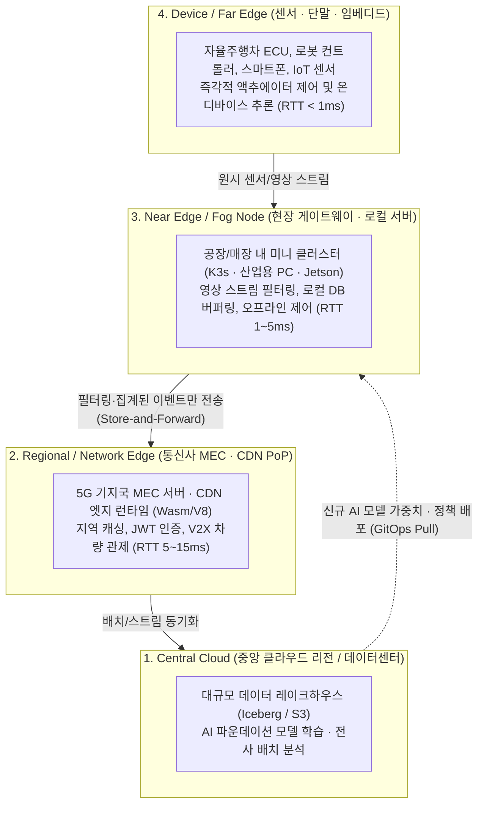
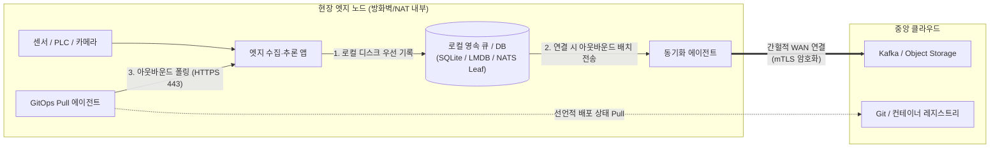

# 엣지 컴퓨팅 (Edge Computing)

엣지 컴퓨팅(Edge Computing)은 센서, 사용자 단말, 공장 게이트웨이, 통신 기지국처럼 **데이터가 실제로 생성되거나 소비되는 물리적 위치(네트워크의 가장자리, Edge)와 가까운 곳에서 연산과 데이터 저장을 수행하는 분산 컴퓨팅 아키텍처**다.

모든 데이터를 원격지의 중앙 클라우드 데이터센터(Central Cloud)로 모아 처리하던 기존 중앙 집중형 구조는 단말과 데이터량이 폭발적으로 늘어나면서 **물리적 왕복 지연 시간(Latency) 한계, 네트워크 대역폭(Bandwidth) 병목, 인터넷 단절 시 현장 마비, 민감 데이터 외부 반출 제약**이라는 한계에 부딪혔다. 엣지 컴퓨팅은 클라우드를 대체하는 것이 아니라, **실시간성·생존성이 필요한 워크로드를 현장으로 전진 배치해 클라우드와 역할을 분담**하는 아키텍처 전략이다.

---

## 1. 클라우드 · 포그(Fog) · 엣지(Edge) 계층 구조

엣지 컴퓨팅은 단일 장비가 아니라 사용자 단말부터 중앙 데이터센터에 이르는 **연속적인 계층(Continuum)**으로 구성된다.

| 구분 | Device / Far Edge (단말 엣지) | Near Edge / Fog (현장 엣지·포그) | Regional / CDN Edge (네트워크 엣지) | Central Cloud (중앙 클라우드) |
| :--- | :--- | :--- | :--- | :--- |
| **물리적 위치** | 센서, 스마트폰, 차량/로봇 내부 | 공장·매장·건물 내 로컬 서버실, 게이트웨이 | 통신사 5G 기지국(MEC), ISP/CDN 거점(PoP) | 하이퍼스케일 리전 데이터센터 |
| **왕복 지연 시간 (RTT)** | `< 1 ms` | `1 ~ 5 ms` | `5 ~ 20 ms` | `30 ~ 150 ms+` |
| **컴퓨팅·전력 자원** | 초저전력 MCU, 모바일 NPU | 소형 x86/ARM 서버, 경량 GPU | 멀티 노드 랙 서버 | 사실상 무제한 확장 가능 |
| **네트워크 단절 내성** | **완전 독립 동작 가능** | **로컬망만으로 자율 동작 가능** | 상위 백본 장애 시 지역 내 동작 | 인터넷 단절 시 현장 서비스 불가 |
| **주요 워크로드** | 센서 신호 처리, 즉각 제동·제어, 온디바이스 AI | 다중 카메라 영상 분석, 프로토콜 변환(Modbus/OPC-UA → MQTT), 로컬 버퍼링 | 엣지 서버리스(인증/라우팅), 클라우드 게이밍, 지역 캐싱 | 대규모 AI 모델 학습, 장기 데이터 보관 및 전사 BI 분석 |

---

## 2. 엣지 컴퓨팅을 도입하는 4가지 기술적 이유

### 1) 물리적 지연 시간(Latency)과 지터(Jitter) 한계 극복
빛이 광케이블을 통과하는 속도와 수많은 라우터 홉(Hop)을 거치는 시간 때문에, 단말에서 중앙 클라우드까지 패킷이 왕복(RTT)하는 데는 아무리 최적화를 해도 평균 `30~100ms` 이상이 걸리며 네트워크 혼잡에 따라 지연 편차(Jitter)도 크게 발생한다.

* 자율주행차의 긴급 제동, 스마트 팩토리의 고속 불량품 에어젯 분류, 로봇 수술 및 AR/VR 렌더링처럼 **`1~10ms` 이내의 결정론적 응답(Deterministic Latency)**이 필요한 작업은 물리적으로 현장(Edge)에서 처리할 수밖에 없다.

### 2) 백홀 대역폭(Backhaul Bandwidth) 및 클라우드 전송 비용 절감
공장 하나에 설치된 100대의 풀HD/4K 비전 검사 카메라가 24시간 내내 원본 영상을 클라우드로 스트리밍하면 수 Gbps의 전용선 대역폭과 막대한 클라우드 스토리지·네트워크 비용이 발생한다.

* 엣지 노드에서 실시간으로 영상을 분석해 **정상 프레임(99.9%)은 로컬에서 폐기하거나 단기 순환 저장**하고, **불량이 감지된 순간의 이미지 클립과 구조화된 메타데이터(JSON/Avro)만 클라우드로 전송**하면 네트워크 트래픽을 90~99% 이상 줄일 수 있다.

### 3) 네트워크 단절 시 자율 생존성 (Offline Autonomy)
운항 중인 선박, 항공기, 지하 광산, 외곽 풍력 발전소, 또는 일시적으로 인터넷 회선이 끊긴 오프라인 매장에서도 핵심 업무는 멈추지 않아야 한다.

* 엣지 노드에 로컬 비즈니스 로직과 경량 스토리지를 배치하면 상위 클라우드와 연결이 끊긴 상태에서도 결제·제어·경보가 정상 작동하고, 연결이 복구되었을 때 쌓여 있던 데이터를 순차 동기화(**Store-and-Forward**)할 수 있다.

### 4) 데이터 프라이버시 및 규제 준수 (Data Sovereignty)
의료 기기 데이터, 스마트 시티 CCTV의 보행자 얼굴 영상, 반도체/배터리 공장의 핵심 공정 파라미터는 보안 및 법적 규제상 외부 퍼블릭 클라우드로 원본 반출이 금지되는 경우가 많다.

* 원본 데이터는 현장 엣지 내부의 휘발성 메모리에서만 처리하고, **얼굴 모자이크(비식별화)가 완료된 영상이나 익명화된 통계 지표만 외부로 내보내는 가드레일** 역할을 수행한다.

---

## 3. 도메인별 대표 구현 형태와 기술 스택

똑같은 "엣지 컴퓨팅"이라는 단어를 쓰더라도 웹 개발자, 인프라 엔지니어, 임베디드/AI 엔지니어가 가리키는 기술 스택은 서로 다르다.

### 1) 클라우드 네이티브 인프라 & Edge Kubernetes
현장의 소형 서버나 게이트웨이 수백 대에 컨테이너 기반 애플리케이션을 배포·관리하는 영역이다. 표준 Kubernetes(`kube-apiserver`, `etcd` 등)는 메모리 점유율이 높고 컨트롤 플레인과 워커 노드 간 연결이 끊기면 Pod가 축출(Eviction)되는 문제가 있어 엣지 전용 경량 배포판을 사용한다.

* **K3s (CNCF Sandbox)**: 불필요한 레거시 드라이버를 제거하고 컨트롤 플레인 컴포넌트를 약 70MB 미만의 단일 바이너리로 패키징한 경량 Kubernetes다. `etcd` 대신 SQLite나 외부 DB를 쓸 수 있어 RAM 512MB~1GB급 엣지 장비에서도 구동된다.
* **KubeEdge / OpenYurt**: 중앙 클라우드에 Kubernetes 컨트롤 플레인을 두고 현장의 엣지 노드들을 원격 워커 노드로 연결하는 프레임워크다. 네트워크가 끊겨도 엣지 노드의 로컬 메타데이터 캐시(`EdgeCore`)를 통해 기존 Pod들을 재시작하거나 계속 구동하는 **Node Autonomy(노드 자율성)** 기능을 제공한다.

### 2) 웹·CDN 서버리스 엣지 (CDN Edge Runtime)
전 세계 주요 도시에 분산된 CDN 거점(PoP)에서 사용자 요청을 가장 먼저 받아 코드를 실행하는 형태다.

* **대표 플랫폼**: Cloudflare Workers, AWS CloudFront Functions / Lambda@Edge, Fastly Compute, Vercel Edge Functions
* **핵심 기술**: 무거운 가상머신(VM)이나 컨테이너 대신 **V8 Isolate** 또는 **WebAssembly(Wasm)** 샌드박스를 사용해 콜드 스타트(Cold Start)를 `1ms` 미만으로 줄인다.
* **주요 활용**: 오리진(Origin) 서버까지 요청이 가기 전에 엣지에서 JWT 서명 검증, 봇(Bot) 트래픽 차단, 다국어/지역별 라우팅, A/B 테스트 쿠키 분기, 정적+동적 HTML 조각 조합(SSR at the Edge)을 처리한다.

### 3) 통신사 MEC (Multi-access Edge Computing)
4G/5G 이동통신망의 기지국이나 지역 교환국(UPF, User Plane Function) 바로 옆에 컴퓨팅 서버를 배치하는 아키텍처다.

* 모바일 단말의 패킷이 통신사 코어망과 일반 인터넷(IX)을 거쳐 클라우드로 나가지 않고, 기지국에서 곧바로 로컬 MEC 서버로 라우팅되므로 무선 구간을 포함해도 `10ms` 내외의 초저지연 통신이 가능하다.
* 스마트 항만 크레인 원격 제어, 공장 내 5G 특화망(이음 5G) 기반 AGV(무인 운반차) 군집 제어, V2X(차량·사물 간 통신)에 주로 쓰인다.

### 4) 온디바이스 & 산업용 Edge AI
클라우드 API를 호출하지 않고 단말이나 현장 장비의 NPU/GPU에서 직접 AI 추론(Inference)을 수행하는 영역이다.

* **하드웨어**: NVIDIA Jetson(Orin/Thor), Apple Silicon(Neural Engine), Qualcomm Snapdragon(Hexagon NPU), Google Coral Edge TPU, Hailo-8
* **모델 경량화 및 런타임**: FP32 모델을 **INT8 / INT4 양자화(Quantization)** 및 지식 증류(Knowledge Distillation)로 압축한 뒤 **ONNX Runtime, NVIDIA TensorRT, LiteRT(구 TensorFlow Lite), ExecuTorch, llama.cpp** 등의 고성능 C++ 런타임으로 구동한다.

---

## 4. 클라우드 ↔ 엣지 연동 아키텍처 설계 시 핵심 패턴

엣지 컴퓨팅 시스템을 실제로 설계하고 운영할 때는 클라우드 백엔드와는 전혀 다른 4가지 제약 조건을 해결해야 한다.

### 1) Store-and-Forward (로컬 버퍼링 후 비동기 전달)
엣지 노드는 언제든 상위 네트워크가 끊길 수 있다는 전제하에 설계해야 한다.

* 애플리케이션이 클라우드 엔드포인트로 직접 동기 HTTP POST를 보내면 네트워크 순단 시 데이터가 즉시 유실되거나 스레드가 블로킹된다.
* 반드시 로컬 디스크 기반의 영속 큐(예: MQTT 브로커 브리징, NATS JetStream Leaf Node, 로컬 파일 스풀링, [LMDB](../FileSystem/LMDB%20(Sysmas%20Lightning%20Memory-mapped%20Database).md) 또는 SQLite)에 먼저 기록한 뒤, 별도의 포워더 프로세스가 백그라운드에서 재시도(Exponential Backoff)하며 클라우드([Kafka](../../Infrastructure/MessageBroker/Kafka/README.md)나 S3)로 밀어 올려야 한다.

### 2) Inbound Push가 아닌 Outbound Pull 기반 배포 (GitOps)
수백~수천 대의 엣지 장비는 대부분 공장·매장의 사설 공유기(NAT)나 방화벽 뒤에 놓여 있어, 중앙 클라우드에서 각 엣지 장비로 SSH 접속이나 Webhook Push를 보낼 수 없다.

* 엣지 노드 내부에 배포 에이전트(예: Rancher Fleet, ArgoCD Pull 모드, 디바이스 관리 에이전트)를 띄우고, **엣지가 중앙 Git 저장소나 컨트롤 플레인을 아웃바운드 HTTPS(443 포트)로 주기적으로 폴링하여 새 컨테이너 이미지와 설정을 가져오는(Pull) 구조**로 설계해야 방화벽 인바운드 포트 개방 없이 안전하게 대규모 장비를 관리할 수 있다.

### 3) 물리적 탈취를 가정한 제로 트러스트 보안 (Zero Trust at the Edge)
출입이 통제되는 클라우드 데이터센터와 달리, 엣지 장비는 누군가 현장에서 장비를 통째로 훔쳐 가거나 SD카드·SSD를 뽑아 분석할 위험이 항상 존재한다.

* **디스크 전체 암호화(LUKS) 및 하드웨어 보안 모듈(TPM 2.0)**: 장비가 탈취되더라도 디스크를 다른 PC에 마운트해 데이터를 읽거나 내부의 AI 모델 가중치·API 키를 추출할 수 없도록 TPM 칩과 연동된 Secure Boot 및 디스크 암호화를 적용한다.
* **기기별 고유 인증서와 mTLS**: 모든 엣지 노드에 공통 API 키 하나를 하드코딩하지 않고, 기기마다 고유 X.509 클라이언트 인증서를 발급해 상호 TLS(mTLS)로 통신함으로써 특정 장비가 침해되더라도 해당 장비의 인증서만 즉시 폐기(Revoke)할 수 있게 구성한다.

### 4) 엣지-클라우드 선순환 파이프라인 (Edge-to-Cloud Flywheel)

* **엣지(Real-time Loop)**: 초당 수십 건의 센서/영상 입력에 대해 `10ms` 이내로 즉시 추론·제어를 수행하고, 판단이 모호한 데이터(Low-confidence Samples)나 요약된 이벤트 로그만 압축 파일(`.avro` 등)로 묶어 클라우드로 업로드한다.
* **클라우드(Batch & Training Loop)**: 전국 엣지 노드에서 올라온 데이터를 데이터 레이크하우스([Iceberg / Parquet](../../Data/Avro_Spark_Iceberg_Trino_Pipeline_Plan.md))에 적재해 드리프트(Drift)를 분석하고, 모델을 재학습한 뒤 새 버전을 다시 엣지 노드로 배포한다.

---

## 5. 관련 문서

* [High Availability (고가용성)](High_Availability.md) — SPOF 제거와 장애 허용(Fault Tolerance) 아키텍처 설계
* [Pipeline (파이프라인 아키텍처)](Pipeline.md) — 단계별 데이터 처리 및 스트림 파이프라인 구조
* [NATS 메시징 시스템](../../Infrastructure/MessageBroker/NATS.md) — 클라우드와 엣지 간 경량 브리징(Leaf Node)에 자주 쓰이는 클라우드 네이티브 메시징
* [로그 수집기 비교 (Fluent-bit vs Vector)](../../Data/Log_Collectors_Comparison.md) — 저사양 엣지 환경에 적합한 경량 에이전트 선택 기준
