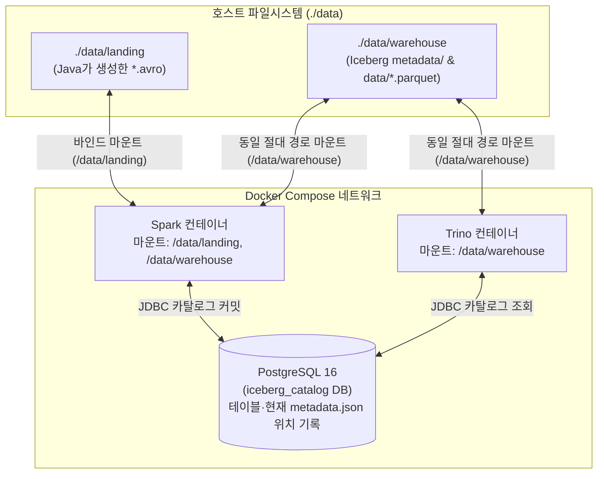

# [Chapter 1] Avro 스키마 설계 및 Spark·Trino 로컬 레이크하우스 공통 인프라 구성

Java에서 생성한 `.avro` 파일을 Apache Spark로 읽어 Apache Iceberg(Parquet) 테이블로 변환하고 Trino에서 조회하려면, 애플리케이션 코드를 작성하기 전에 먼저 **1) 세 엔진(Java, Spark, Trino)에서 타입 충돌이 나지 않는 Avro 스키마(`.avsc`)**와 **2) Spark와 Trino가 동일한 테이블 메타데이터와 물리 파일을 바라보는 공유 인프라**를 구성해야 한다.

이 문서는 [Java Avro 저장부터 Spark Iceberg(Parquet) 변환·Trino 조회까지의 파이프라인 설계](Avro_Spark_Iceberg_Trino_Pipeline_Plan.md)의 **Chapter 1** 상세 가이드로, 데이터 타입 매핑 규칙, 스키마 설계 원칙, 그리고 Docker Compose 기반의 로컬 레이크하우스 환경 구성을 다룬다.

---

## 1. Java · Spark · Iceberg · Trino 데이터 타입 매핑과 스키마 설계

데이터가 **Avro 파일(Java) → Spark DataFrame → Iceberg Table(Parquet) → Trino SQL**로 이동할 때 각 엔진의 데이터 타입 체계가 조금씩 다르다. 처음 스키마를 정의할 때 아래 매핑표를 기준으로 설계해야 중간 변환 단계에서 정밀도 손실이나 캐스팅 오류를 피할 수 있다.

### 1) 엔진별 핵심 데이터 타입 매핑표

| 의미 | Avro 스키마 (`.avsc`) | Java 타입 (`SpecificRecord` / `GenericRecord`) | Spark SQL / Iceberg 타입 | Trino SQL 타입 |
| :--- | :--- | :--- | :--- | :--- |
| **문자열** | `"string"` | `String` / `Utf8` (`CharSequence`) | `STRING` | `VARCHAR` |
| **32비트 정수** | `"int"` | `int` / `Integer` | `INT` | `INTEGER` |
| **64비트 정수** | `"long"` | `long` / `Long` | `BIGINT` | `BIGINT` |
| **배정밀도 실수** | `"double"` | `double` / `Double` | `DOUBLE` | `DOUBLE` |
| **고정소수점(금액/수수료)** | `{"type": "bytes", "logicalType": "decimal", "precision": 18, "scale": 2}` | `java.math.BigDecimal` | `DECIMAL(18, 2)` | `DECIMAL(18, 2)` |
| **일자(Date)** | `{"type": "int", "logicalType": "date"}` | `java.time.LocalDate` (또는 Epoch Days `int`) | `DATE` | `DATE` |
| **이벤트 시각(UTC)** | `{"type": "long", "logicalType": "timestamp-millis"}` | `java.time.Instant` (또는 Epoch Millis `long`) | `TIMESTAMP` (`timestamptz`) | `TIMESTAMP(6) WITH TIME ZONE` |
| **선택(Nullable) 필드** | `["null", "string"]`, `"default": null` | `@Nullable String` | `STRING` (Nullable) | `VARCHAR` (Nullable) |

### 2) 실무 Avro 스키마 설계 4대 원칙

1. **시각(Timestamp) 필드는 문자열이 아닌 논리 타입(`timestamp-millis` / `timestamp-micros`)을 사용한다**
   * 시각을 `"2026-11-07T08:30:00Z"` 같은 문자열(`"string"`)로 저장하면 Spark에서 매번 `to_timestamp()` 파싱 비용이 발생하고, 무엇보다 Iceberg의 핵심 기능인 **히든 파티셔닝(`PARTITIONED BY (days(event_time))`)**을 바로 적용할 수 없다.
   * `{"type": "long", "logicalType": "timestamp-millis"}`로 정의하면 Java에서는 Epoch Millis(`long`) 또는 `Instant`로 기록하고, Spark의 `spark-avro` 리더가 자동으로 `TimestampType`으로 변환해 준다.
2. **Nullable 필드는 반드시 `["null", "<타입>"]` 순서로 선언하고 `"default": null`을 명시한다**
   * Avro 스키마 진화(Schema Evolution)에서 기본값(`default`)은 선택이 아니라 필수다. 향후 컬럼이 추가되거나 제거될 때 `"default": null`이 있어야 구버전 `.avro` 파일을 신버전 스키마로 읽어도 깨지지 않는다.
   * 또한 Avro 명세상 `"default"` 값의 타입은 Union 배열의 **첫 번째 타입**과 일치해야 하므로, `"default": null`을 쓰려면 반드시 `"null"`이 배열의 맨 앞(`["null", "string"]`)에 와야 한다.
3. **상태값(Status)은 Avro `enum` 대신 `"string"`을 권장한다**
   * Avro `enum` 타입은 정의되지 않은 심볼(예: 기존 `CREATED`, `PAID`에 추후 `REFUNDED`가 추가됨)이 들어오면 리더/라이터 스키마 버전을 동시에 올리지 않는 한 즉시 역직렬화 예외를 발생시킨다.
   * 게다가 Spark와 Iceberg는 Avro `enum`을 읽을 때 어차피 `STRING`으로 변환하므로, 수집 스키마에서도 `"string"`으로 정의하고 애플리케이션 레벨에서 검증하는 편이 파이프라인 운영에 훨씬 안전하다.
4. **Java 코드 생성기를 쓸 때는 Avro `1.12.2` 이상을 사용한다 (`AVRO-4183`)**
   * Avro `1.12.1`에서는 스키마에 `result`라는 이름의 필드가 있으면 생성된 Java 클래스의 `hashCode()` 내부 지역 변수(`int result = 1;`)와 이름이 겹쳐 컴파일 오류가 발생한다. 자세한 내용은 [Avro result 필드와 hashCode 지역 변수 충돌](Avro_HashCode_Field_Naming_Conflict.md)을 참고한다.

### 3) 주문 이벤트 Avro 스키마 확정 (`schemas/order_event.avsc`)

Chapter 2~5 전반에서 공통으로 사용할 주문 이벤트 스키마다.

```json
{
  "type": "record",
  "name": "OrderEvent",
  "namespace": "com.example.pipeline.avro",
  "doc": "주문 이벤트 수집용 Avro 스키마 (v1)",
  "fields": [
    {
      "name": "event_id",
      "type": "string",
      "doc": "이벤트 고유 식별자 (UUID 문자열)"
    },
    {
      "name": "order_id",
      "type": "long",
      "doc": "주문 번호"
    },
    {
      "name": "user_id",
      "type": "string",
      "doc": "주문 고객 ID"
    },
    {
      "name": "order_status",
      "type": "string",
      "doc": "주문 상태 (CREATED, PAID, CANCELLED)"
    },
    {
      "name": "total_amount",
      "type": "long",
      "doc": "총 결제 금액 (원화 정수)"
    },
    {
      "name": "coupon_code",
      "type": ["null", "string"],
      "default": null,
      "doc": "적용된 할인 쿠폰 코드 (미적용 시 null)"
    },
    {
      "name": "event_time",
      "type": {
        "type": "long",
        "logicalType": "timestamp-millis"
      },
      "doc": "이벤트 발생 시각 (UTC Epoch Milliseconds)"
    }
  ]
}
```

---

## 2. Spark와 Trino가 Iceberg 테이블을 공유하는 원리

로컬 환경에서 Spark로 Iceberg 테이블을 만들었는데 Trino에서 테이블이 보이지 않거나 조회 시 에러가 나는 이유는 크게 두 가지다.



1. **카탈로그(Catalog) 공유 필수**
   * Iceberg에서 카탈로그는 **"현재 테이블의 최신 `metadata.json` 파일이 스토리지의 어느 경로에 있는가"**를 원자적(Atomic)으로 가리키는 포인터 저장소다.
   * Spark 내부의 기본 인메모리/Derby 카탈로그를 쓰면 외부 프로세스인 Trino가 이 포인터를 알 수 없다. 가장 가볍고 확실한 방법은 **PostgreSQL 컨테이너 1개를 띄워 Spark와 Trino 양쪽 모두 Iceberg JDBC Catalog로 연결**하는 것이다.
2. **컨테이너 내부 Warehouse 마운트 경로 일치 필수**
   * Spark가 Iceberg 테이블에 데이터를 쓰면 매니페스트 파일(`*.avro`) 안에 실제 Parquet 데이터 파일의 경로를 `/data/warehouse/commerce/order_events/data/.../00000.parquet`처럼 **절대 경로**로 기록한다.
   * 따라서 Trino 컨테이너에서도 호스트의 Warehouse 디렉터리를 **정확히 동일한 컨테이너 내부 경로(`/data/warehouse`)**로 마운트해야 Trino 워커가 해당 Parquet 파일을 열 수 있다. (S3나 MinIO 같은 오브젝트 스토리지를 쓸 때도 버킷 URI `s3://warehouse/...`와 엔드포인트를 양쪽에 동일하게 맞춘다.)

---

## 3. 로컬 레이크하우스 디렉터리 구조 및 설정 파일

실습 프로젝트를 위한 디렉터리 구조는 다음과 같이 구성한다.

```text
avro-iceberg-trino-lab/
├── docker-compose.yml
├── schemas/
│   └── order_event.avsc
├── spark/
│   └── spark-defaults.conf
├── trino/
│   └── catalog/
│       └── iceberg.properties
└── data/
    ├── landing/      # Chapter 2에서 Java가 .avro 파일을 저장할 경로
    └── warehouse/    # Chapter 3~4에서 Spark와 Trino가 공유할 Iceberg 저장소 경로
```

### 1) `docker-compose.yml` 작성

PostgreSQL(Iceberg JDBC 카탈로그), Spark, Trino 3개 서비스를 하나의 네트워크로 묶고 `./data/warehouse`를 `/data/warehouse`로 동일하게 마운트한다.

```yaml
services:
  postgres-catalog:
    image: postgres:16-alpine
    container_name: iceberg-postgres
    environment:
      POSTGRES_USER: iceberg
      POSTGRES_PASSWORD: iceberg_password
      POSTGRES_DB: iceberg_catalog
    ports:
      - "5432:5432"
    healthcheck:
      test: ["CMD-SHELL", "pg_isready -U iceberg -d iceberg_catalog"]
      interval: 5s
      timeout: 5s
      retries: 5

  spark-iceberg:
    image: apache/spark:3.5.5-java17
    container_name: spark-iceberg
    user: root
    depends_on:
      postgres-catalog:
        condition: service_healthy
    volumes:
      - ./data/landing:/data/landing
      - ./data/warehouse:/data/warehouse
      - ./schemas:/data/schemas:ro
      - ./spark/spark-defaults.conf:/opt/spark/conf/spark-defaults.conf:ro
    command: ["sleep", "infinity"]

  trino:
    image: trinodb/trino:473
    container_name: trino-iceberg
    depends_on:
      postgres-catalog:
        condition: service_healthy
    ports:
      - "8080:8080"
    volumes:
      - ./data/warehouse:/data/warehouse
      - ./trino/catalog/iceberg.properties:/etc/trino/catalog/iceberg.properties:ro
```

> [!TIP]
> Trino 컨테이너는 내부적으로 `trino` 사용자(UID `1000`)로 실행되고 Spark 컨테이너는 설정에 따라 다른 UID로 파일을 생성할 수 있다. 로컬 바인드 마운트 환경에서 권한 거부(`AccessDeniedException`)를 막기 위해 실습용 `./data/warehouse` 디렉터리는 생성 직후 `chmod -R 777 data/warehouse`로 쓰기 권한을 열어 두거나 컨테이너 UID를 `1000:1000`으로 통일하는 것이 편하다.

### 2) Spark 카탈로그 기본 설정 (`spark/spark-defaults.conf`)

매번 `spark-sql`이나 `spark-submit`을 실행할 때 긴 카탈로그 옵션을 반복 입력하지 않도록 `spark-defaults.conf`에 `lakehouse` 카탈로그와 필수 패키지(`spark-avro`, `iceberg-spark-runtime`, `postgresql`)를 지정한다.

```properties
# Avro 데이터소스, Iceberg Spark 런타임, PostgreSQL JDBC 드라이버 자동 로드
spark.jars.packages                                  org.apache.spark:spark-avro_2.12:3.5.5,org.apache.iceberg:iceberg-spark-runtime-3.5_2.12:1.7.1,org.postgresql:postgresql:42.7.5

# Iceberg SQL 확장 활성화 (CALL 프로시저, MERGE INTO, ALTER TABLE 등 지원)
spark.sql.extensions                                 org.apache.iceberg.spark.extensions.IcebergSparkSessionExtensions

# 'lakehouse'라는 이름의 Iceberg JDBC 카탈로그 등록
spark.sql.catalog.lakehouse                          org.apache.iceberg.spark.SparkCatalog
spark.sql.catalog.lakehouse.type                     jdbc
spark.sql.catalog.lakehouse.uri                      jdbc:postgresql://postgres-catalog:5432/iceberg_catalog
spark.sql.catalog.lakehouse.jdbc.user                iceberg
spark.sql.catalog.lakehouse.jdbc.password            iceberg_password
spark.sql.catalog.lakehouse.warehouse                /data/warehouse

# 타임존을 UTC로 고정하여 Java Instant -> Spark -> Trino 간 시간차 왜곡 방지
spark.sql.session.timeZone                           UTC
```

### 3) Trino Iceberg 카탈로그 설정 (`trino/catalog/iceberg.properties`)

Trino가 Spark와 정확히 같은 PostgreSQL DB(`jdbc:postgresql://postgres-catalog:5432/iceberg_catalog`)와 Warehouse 경로(`/data/warehouse`)를 참조하도록 설정한다.

```ini
connector.name=iceberg
iceberg.catalog.type=jdbc
iceberg.jdbc-catalog.driver-class=org.postgresql.Driver
iceberg.jdbc-catalog.connection-url=jdbc:postgresql://postgres-catalog:5432/iceberg_catalog
iceberg.jdbc-catalog.connection-user=iceberg
iceberg.jdbc-catalog.connection-password=iceberg_password
iceberg.jdbc-catalog.default-warehouse-dir=/data/warehouse
iceberg.file-format=PARQUET
fs.native-local.enabled=true
local.location=/data/warehouse
```

> [!NOTE]
> 최신 Trino(450 이상)의 Iceberg 커넥터에서 S3/HDFS가 아닌 로컬 파일시스템 경로(`/data/warehouse`)를 읽으려면 `fs.native-local.enabled=true`와 `local.location=/data/warehouse` 설정을 반드시 추가해야 한다.

---

## 4. Chapter 1 완료 검증 (인프라 기동 및 연동 스모크 테스트)

Chapter 2(Java Avro 파일 생성)로 넘어가기 전에 아래 3단계 검증으로 공통 인프라가 정상 동작하는지 확인한다.

### Step 1. 디렉터리 생성 및 Avro 스키마 JSON 문법 검증

```bash
mkdir -p data/landing data/warehouse spark trino/catalog schemas
chmod -R 777 data/landing data/warehouse

# order_event.avsc JSON 유효성 검사 (에러 없이 포맷팅된 JSON이 출력되면 정상)
python3 -m json.tool schemas/order_event.avsc > /dev/null && echo "Schema JSON OK"
```

### Step 2. Docker Compose 기동 및 Spark에서 네임스페이스 생성

```bash
docker compose up -d

# Spark 컨테이너에서 lakehouse.commerce 네임스페이스 생성
docker exec -it spark-iceberg /opt/spark/bin/spark-sql \
  -e "CREATE NAMESPACE IF NOT EXISTS lakehouse.commerce; SHOW NAMESPACES IN lakehouse;"
```

첫 실행 시 Spark가 PostgreSQL(`iceberg_catalog`) 안에 `iceberg_tables`와 `iceberg_namespace_properties`라는 카탈로그 메타데이터 테이블 2개를 자동으로 생성하고 `commerce` 네임스페이스를 등록한다.

### Step 3. Trino에서 동일 네임스페이스 조회 확인

```bash
# Trino CLI로 접속하여 Spark가 만든 'commerce' 스키마가 보이는지 확인
docker exec -it trino-iceberg trino --execute "SHOW SCHEMAS IN iceberg;"
```

출력 결과에 `commerce`와 `information_schema`가 함께 나타나면 **Spark와 Trino 사이의 Iceberg 카탈로그 연동이 완료**된 것이다.

---

## 5. 다음 단계

* **전체 파이프라인 로드맵**: [Java Avro 저장부터 Spark Iceberg(Parquet) 변환·Trino 조회까지의 파이프라인 설계](Avro_Spark_Iceberg_Trino_Pipeline_Plan.md)
* **다음 챕터 (Chapter 2)**: [[Chapter 2] Java에서 Apache Avro로 `.avro` 컨테이너 파일 생성 및 검증](Avro_Iceberg_Trino_Ch2_Java_Avro_Writer.md) — `schemas/order_event.avsc`를 사용해 `DataFileWriter` / `DataFileReader`로 `data/landing/*.avro` 컨테이너 파일을 생성하고 검증한다.
