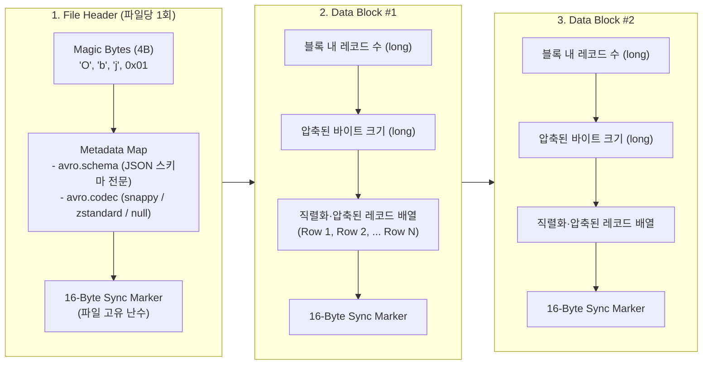

# [Chapter 2] Java에서 Apache Avro로 `.avro` 컨테이너 파일 생성 및 검증

[Chapter 1](Avro_Iceberg_Trino_Ch1_Schema_and_Infra.md)에서 설계한 `schemas/order_event.avsc` 스키마와 공유 디렉터리(`data/landing/`)가 준비되었다면, 두 번째 단계는 **Java 애플리케이션에서 Apache Avro(`1.12.2`) 라이브러리를 사용해 `.avro` 컨테이너 파일을 생성하고 역직렬화로 검증**하는 것이다.

이 문서에서는 `.avro` 컨테이너 파일의 내부 바이너리 구조와 왜 이 구조가 Spark 분산 처리에 유리한지 살펴보고, **`GenericRecord`(동적 스키마)** 방식과 **`SpecificRecord`(코드 생성 + 빌더)** 방식 두 가지로 `.avro` 파일을 생성·검증하는 실행 가능한 예제 코드를 정리한다.

---

## 1. Avro Object Container File (`.avro`)의 내부 구조

Kafka 같은 메시지 브로커에 단일 Avro 레코드를 보낼 때는 보통 스키마 본문 없이 5바이트(Magic Byte + 4바이트 Schema ID)와 직렬화된 값만 전송한다. 반면 파일시스템이나 오브젝트 스토리지(Landing Zone)에 저장하는 **`.avro` 파일(Object Container File)**은 외부 스키마 레지스트리 없이도 파일 하나만으로 완벽히 자기 기술(Self-describing)이 가능하도록 설계되어 있다.



### 왜 이 구조가 Spark 수집(Chapter 3)에 유리한가?

1. **별도 스키마 지정 없이 즉시 로드 가능**: 파일 헤더의 `avro.schema` 메타데이터에 JSON 스키마 전문이 들어 있으므로, Spark에서 `spark.read.format("avro").load(...)`만 호출해도 컬럼명, 타입, 논리 타입(`timestamp-millis`)을 즉시 복원한다.
2. **매 레코드마다 필드명을 반복 저장하지 않음**: JSON 파일은 모든 줄마다 `"order_id":`, `"event_time":` 문자열을 반복 기록하지만, Avro 데이터 블록 내부에는 오직 값(Value)만 바이너리로 촘촘히 기록된다.
3. **16바이트 Sync Marker를 통한 병렬 분할 읽기(Splittable)**: 대용량 `.avro` 파일 하나(예: 1GB)를 읽을 때 Spark의 여러 Executor Task가 파일을 바이트 오프셋 단위로 쪼개어 중간 지점부터 읽더라도, 16바이트 Sync Marker를 찾아 다음 데이터 블록의 시작점을 정확히 맞출 수 있다.

---

## 2. Java Avro 직렬화 방식 비교: `GenericRecord` vs `SpecificRecord`

Apache Avro Java 라이브러리는 레코드를 다루는 두 가지 주요 API를 제공한다.

| 구분 | `GenericRecord` (`GenericDatumWriter`) | `SpecificRecord` (`SpecificDatumWriter`) |
| :--- | :--- | :--- |
| **동작 방식** | 런타임에 `.avsc` 파일을 파싱해 `Map`처럼 `record.put("필드명", 값)`으로 데이터 입력 | 빌드 시점(`avro-maven-plugin`)에 `.avsc`로부터 Java 클래스(`OrderEvent.java`)를 생성해 Builder로 입력 |
| **타입 안전성** | **낮음** (필드명 오타나 잘못된 타입 전달 시 런타임에 `AvroRuntimeException` 발생) | **높음** (컴파일 타임에 필드명과 타입 검증, IDE 자동완성 지원) |
| **논리 타입(`timestamp-millis`)** | 개발자가 직접 `long`(Epoch Millis)으로 변환해 넣어야 함 | 플러그인 설정 시 `java.time.Instant`를 그대로 전달 가능 |
| **권장 사용처** | 스키마가 외부에서 동적으로 바뀌는 범용 수집기·라우터, 빠른 프로토타이핑 | 도메인 스키마가 명확한 애플리케이션 서비스 및 배치 생산자 (**실무 권장**) |

---

## 3. Maven 프로젝트 의존성 및 플러그인 설정 (`pom.xml`)

Java 21 환경에서 Avro `1.12.2`와 Snappy 압축 코덱, 그리고 `SpecificRecord` 코드 생성을 위한 `avro-maven-plugin`을 설정한다.

```xml
<project xmlns="http://maven.apache.org/POM/4.0.0"
         xmlns:xsi="http://www.w3.org/2001/XMLSchema-instance"
         xsi:schemaLocation="http://maven.apache.org/POM/4.0.0 https://maven.apache.org/xsd/maven-4.0.0.xsd">
    <modelVersion>4.0.0</modelVersion>

    <groupId>com.example</groupId>
    <artifactId>avro-producer-lab</artifactId>
    <version>1.0.0</version>

    <properties>
        <maven.compiler.release>21</maven.compiler.release>
        <project.build.sourceEncoding>UTF-8</project.build.sourceEncoding>
        <avro.version>1.12.2</avro.version>
    </properties>

    <dependencies>
        <!-- Apache Avro 코어 (1.12.2 이상 필수: AVRO-4183 hashCode 변수 충돌 패치 포함) -->
        <dependency>
            <groupId>org.apache.avro</groupId>
            <artifactId>avro</artifactId>
            <version>${avro.version}</version>
        </dependency>

        <!-- Snappy 블록 압축 코덱 -->
        <dependency>
            <groupId>org.xerial.snappy</groupId>
            <artifactId>snappy-java</artifactId>
            <version>1.1.10.7</version>
        </dependency>

        <!-- Avro 내부 로깅 구현체 -->
        <dependency>
            <groupId>org.slf4j</groupId>
            <artifactId>slf4j-simple</artifactId>
            <version>2.0.16</version>
        </dependency>
    </dependencies>

    <build>
        <plugins>
            <!-- SpecificRecord용 Java 클래스 자동 생성 플러그인 -->
            <plugin>
                <groupId>org.apache.avro</groupId>
                <artifactId>avro-maven-plugin</artifactId>
                <version>${avro.version}</version>
                <executions>
                    <execution>
                        <phase>generate-sources</phase>
                        <goals>
                            <goal>schema</goal>
                        </goals>
                        <configuration>
                            <!-- Chapter 1에서 작성한 스키마 경로 -->
                            <sourceDirectory>${project.basedir}/../schemas</sourceDirectory>
                            <outputDirectory>${project.build.directory}/generated-sources/avro</outputDirectory>
                            <!-- 기본 CharSequence(Utf8) 대신 불변 java.lang.String 사용 -->
                            <stringType>String</stringType>
                            <!-- decimal 논리 타입을 BigDecimal로 매핑 -->
                            <enableDecimalLogicalType>true</enableDecimalLogicalType>
                        </configuration>
                    </execution>
                </executions>
            </plugin>
        </plugins>
    </build>
</project>
```

> [!TIP]
> `avro-maven-plugin`의 기본 설정은 문자열 필드를 `java.lang.CharSequence`(내부 구현체 `org.apache.avro.util.Utf8`)로 생성한다. `Utf8` 객체는 가변(Mutable) 버퍼를 재사용하므로 `Map`의 Key로 쓰거나 동등성(`equals`) 비교를 할 때 예기치 않은 버그를 유발하기 쉽다. `<stringType>String</stringType>`을 지정해 처음부터 `java.lang.String`으로 생성하는 것이 안전하다.

---

## 4. 구현 1: `GenericRecord`를 이용한 `.avro` 생성·추가·검증

코드 생성 단계 없이 `.avsc` 파일만 읽어서 즉시 실행할 수 있는 예제다. Chapter 3에서 Spark가 읽어들일 수 있도록 **`data/landing/orders_20261107.avro` 파일에 총 5건의 샘플 데이터(최초 생성 3건 + 기존 파일 Append 2건)**를 기록하고, `DataFileReader`로 다시 읽어 검증한다.

```java
package com.example.pipeline;

import org.apache.avro.Schema;
import org.apache.avro.file.CodecFactory;
import org.apache.avro.file.DataFileReader;
import org.apache.avro.file.DataFileWriter;
import org.apache.avro.generic.GenericData;
import org.apache.avro.generic.GenericDatumReader;
import org.apache.avro.generic.GenericDatumWriter;
import org.apache.avro.generic.GenericRecord;
import org.apache.avro.io.DatumReader;
import org.apache.avro.io.DatumWriter;

import java.io.File;
import java.io.IOException;
import java.nio.file.Files;
import java.nio.file.Path;
import java.time.Instant;
import java.util.List;
import java.util.UUID;

public class GenericOrderEventWriter {

    public static void main(String[] args) throws IOException {
        // 1. Chapter 1에서 정의한 Avro 스키마 파일 파싱
        Path schemaPath = Path.of("schemas/order_event.avsc");
        Schema schema = new Schema.Parser().parse(schemaPath.toFile());

        Path outputPath = Path.of("data/landing/orders_20261107.avro");
        Files.createDirectories(outputPath.getParent());
        File avroFile = outputPath.toFile();

        // 2. 최초 3건 레코드 생성 및 새 .avro 컨테이너 파일 쓰기 (create)
        List<GenericRecord> initialBatch = List.of(
                createRecord(schema, 10001L, "user-kim", "PAID", 45000L, "WELCOME10", "2026-11-07T01:10:00Z"),
                createRecord(schema, 10002L, "user-lee", "CREATED", 128000L, null, "2026-11-07T01:15:30Z"),
                createRecord(schema, 10003L, "user-park", "PAID", 89000L, "VIP20", "2026-11-07T02:05:10Z")
        );

        DatumWriter<GenericRecord> datumWriter = new GenericDatumWriter<>(schema);
        try (DataFileWriter<GenericRecord> writer = new DataFileWriter<>(datumWriter)) {
            // Snappy 블록 압축 설정 (create 호출 전에 지정해야 적용됨)
            writer.setCodec(CodecFactory.snappyCodec());
            writer.create(schema, avroFile);
            for (GenericRecord record : initialBatch) {
                writer.append(record);
            }
        }
        System.out.println("1차 파일 생성 완료 (3건): " + avroFile.getAbsolutePath());

        // 3. 기존 .avro 파일 끝에 2건 이어 쓰기 (appendTo)
        // 다음 날짜(2026-11-08) 이벤트 2건을 추가해 Chapter 3에서 Iceberg 일자별 파티셔닝을 함께 검증한다.
        List<GenericRecord> secondBatch = List.of(
                createRecord(schema, 10004L, "user-choi", "CANCELLED", 32000L, null, "2026-11-08T00:20:00Z"),
                createRecord(schema, 10005L, "user-kim", "PAID", 64000L, "REPEAT5", "2026-11-08T03:45:00Z")
        );

        try (DataFileWriter<GenericRecord> appendWriter = new DataFileWriter<>(datumWriter)) {
            appendWriter.appendTo(avroFile);
            for (GenericRecord record : secondBatch) {
                appendWriter.append(record);
            }
        }
        System.out.println("2차 파일 Append 완료 (+2건, 총 5건)");

        // 4. DataFileReader를 이용한 역직렬화 검증
        // 외부에서 schema를 전달하지 않아도 파일 헤더에 내장된 avro.schema로 읽을 수 있다.
        DatumReader<GenericRecord> datumReader = new GenericDatumReader<>();
        try (DataFileReader<GenericRecord> reader = new DataFileReader<>(avroFile, datumReader)) {
            System.out.println("=== 파일 헤더 내장 스키마: " + reader.getSchema().getFullName() + " ===");
            System.out.println("=== 압축 코덱 메타데이터: " + reader.getMetaString("avro.codec") + " ===");

            GenericRecord reusableRecord = null;
            int count = 0;
            while (reader.hasNext()) {
                // reader.next(reusableRecord)에 기존 인스턴스를 넘기면 객체를 재사용해 대량 읽기 시 GC 부담을 줄인다.
                reusableRecord = reader.next(reusableRecord);
                count++;
                long epochMillis = (Long) reusableRecord.get("event_time");
                System.out.printf("[%d] order_id=%d | user=%s | status=%s | amount=%d | coupon=%s | time=%s%n",
                        count,
                        reusableRecord.get("order_id"),
                        reusableRecord.get("user_id"),
                        reusableRecord.get("order_status"),
                        reusableRecord.get("total_amount"),
                        reusableRecord.get("coupon_code"),
                        Instant.ofEpochMilli(epochMillis));
            }
            System.out.println("총 검증 완료 건수: " + count);
        }
    }

    private static GenericRecord createRecord(
            Schema schema,
            long orderId,
            String userId,
            String status,
            long amount,
            String couponCode,
            String isoUtcTime) {
        GenericRecord record = new GenericData.Record(schema);
        record.put("event_id", UUID.randomUUID().toString());
        record.put("order_id", orderId);
        record.put("user_id", userId);
        record.put("order_status", status);
        record.put("total_amount", amount);
        record.put("coupon_code", couponCode);
        record.put("event_time", Instant.parse(isoUtcTime).toEpochMilli());
        return record;
    }
}
```

---

## 5. 구현 2: `SpecificRecord`(코드 생성 + Builder) 실무 권장 방식

`mvn generate-sources`를 실행하면 `target/generated-sources/avro/com/example/pipeline/avro/OrderEvent.java` 클래스가 자동 생성된다. 생성된 클래스의 `OrderEvent.newBuilder()`를 사용하면 다음과 같은 이점이 있다.

1. **필수 필드 누락 및 기본값 자동 처리**: `build()` 호출 시 스키마의 필수 필드가 빠졌으면 즉시 예외를 던지고, `coupon_code`처럼 `"default": null`이 선언된 필드는 값을 세팅하지 않아도 자동으로 기본값(`null`)을 채워 준다.
2. **`java.time.Instant` 직접 사용**: `avro-maven-plugin`이 `"logicalType": "timestamp-millis"`를 인식하여 `setEventTime(Instant)` 메서드를 생성하므로 수동으로 `.toEpochMilli()`를 호출할 필요가 없다.

```java
package com.example.pipeline;

import com.example.pipeline.avro.OrderEvent;
import org.apache.avro.file.CodecFactory;
import org.apache.avro.file.DataFileReader;
import org.apache.avro.file.DataFileWriter;
import org.apache.avro.io.DatumReader;
import org.apache.avro.io.DatumWriter;
import org.apache.avro.specific.SpecificDatumReader;
import org.apache.avro.specific.SpecificDatumWriter;

import java.io.File;
import java.io.IOException;
import java.time.Instant;
import java.util.UUID;

public class SpecificOrderEventWriter {

    public static void main(String[] args) throws IOException {
        File avroFile = new File("data/landing/orders_specific_sample.avro");

        // 1. Builder 패턴으로 타입 안전하게 레코드 생성
        OrderEvent event = OrderEvent.newBuilder()
                .setEventId(UUID.randomUUID().toString())
                .setOrderId(20001L)
                .setUserId("user-jung")
                .setOrderStatus("PAID")
                .setTotalAmount(55000L)
                // setCouponCode(...)를 생략하면 스키마의 "default": null이 자동 적용됨
                .setEventTime(Instant.parse("2026-11-07T05:00:00Z"))
                .build();

        // 2. SpecificDatumWriter로 파일 기록
        DatumWriter<OrderEvent> writer = new SpecificDatumWriter<>(OrderEvent.class);
        try (DataFileWriter<OrderEvent> fileWriter = new DataFileWriter<>(writer)) {
            fileWriter.setCodec(CodecFactory.snappyCodec());
            fileWriter.create(OrderEvent.getClassSchema(), avroFile);
            fileWriter.append(event);
        }

        // 3. SpecificDatumReader로 타입 안전하게 읽기
        DatumReader<OrderEvent> reader = new SpecificDatumReader<>(OrderEvent.class);
        try (DataFileReader<OrderEvent> fileReader = new DataFileReader<>(avroFile, reader)) {
            while (fileReader.hasNext()) {
                OrderEvent loaded = fileReader.next();
                // getEventTime()이 곧바로 java.time.Instant를 반환한다.
                System.out.printf("orderId=%d, coupon=%s, eventTime=%s%n",
                        loaded.getOrderId(),
                        loaded.getCouponCode(),
                        loaded.getEventTime());
            }
        }
    }
}
```

---

## 6. Chapter 2 완료 검증 체크리스트

Java 코드를 실행해 `data/landing/orders_20261107.avro` 파일이 생성되었다면, Chapter 3(Spark 적재)으로 넘어가기 전에 다음 세 가지를 확인한다.

### 1) Java 실행 출력 결과 확인
`GenericOrderEventWriter` 실행 시 아래와 같이 코덱(`snappy`)과 5건의 레코드가 정상 출력되어야 한다.

```text
1차 파일 생성 완료 (3건): /.../data/landing/orders_20261107.avro
2차 파일 Append 완료 (+2건, 총 5건)
=== 파일 헤더 내장 스키마: com.example.pipeline.avro.OrderEvent ===
=== 압축 코덱 메타데이터: snappy ===
[1] order_id=10001 | user=user-kim | status=PAID | amount=45000 | coupon=WELCOME10 | time=2026-11-07T01:10:00Z
[2] order_id=10002 | user=user-lee | status=CREATED | amount=128000 | coupon=null | time=2026-11-07T01:15:30Z
[3] order_id=10003 | user=user-park | status=PAID | amount=89000 | coupon=VIP20 | time=2026-11-07T02:05:10Z
[4] order_id=10004 | user=user-choi | status=CANCELLED | amount=32000 | coupon=null | time=2026-11-08T00:20:00Z
[5] order_id=10005 | user=user-kim | status=PAID | amount=64000 | coupon=REPEAT5 | time=2026-11-08T03:45:00Z
총 검증 완료 건수: 5
```

### 2) 파일 바이너리 헤더(Magic Bytes 및 내장 스키마) 확인
터미널에서 `head -c 300` 또는 `xxd`로 생성된 `.avro` 파일의 앞부분을 조회하면 `Obj\x01` 매직 헤더와 `avro.schema` JSON 문자열이 그대로 들어 있는 것을 눈으로 확인할 수 있다.

```bash
xxd -l 64 data/landing/orders_20261107.avro
```

```text
00000000: 4f62 6a01 0414 6176 726f 2e63 6f64 6563  Obj...avro.codec
00000010: 0c73 6e61 7070 7916 6176 726f 2e73 6368  .snappy.avro.sch
00000020: 656d 61ba 077b 2274 7970 6522 3a22 7265  ema..{"type":"re
00000030: 636f 7264 222c 226e 616d 6522 3a22 4f72  cord","name":"Or
```

### 3) Spark 컨테이너 내부에서 `.avro` 파일 접근 확인
Chapter 1에서 마운트해 둔 Spark 컨테이너의 `/data/landing` 경로에서 해당 파일이 보이는지 확인한다.

```bash
docker exec -it spark-iceberg ls -lh /data/landing/orders_20261107.avro
```

---

## 7. 관련 문서 및 다음 단계

* **전체 파이프라인 로드맵**: [Java Avro 저장부터 Spark Iceberg(Parquet) 변환·Trino 조회까지의 파이프라인 설계](Avro_Spark_Iceberg_Trino_Pipeline_Plan.md)
* **이전 챕터 (Chapter 1)**: [Avro 스키마 설계 및 Spark·Trino 로컬 레이크하우스 공통 인프라 구성](Avro_Iceberg_Trino_Ch1_Schema_and_Infra.md)
* **참고 트러블슈팅**: [Avro result 필드와 hashCode 지역 변수 충돌](Avro_HashCode_Field_Naming_Conflict.md)
* **다음 챕터 (Chapter 3)**: Spark(`spark-avro` + `iceberg-spark-runtime`)에서 `/data/landing/orders_20261107.avro`를 읽어 `lakehouse.commerce.order_events` Iceberg(Parquet) 테이블로 적재하고 생성된 메타데이터·Parquet 파일을 분석한다.
