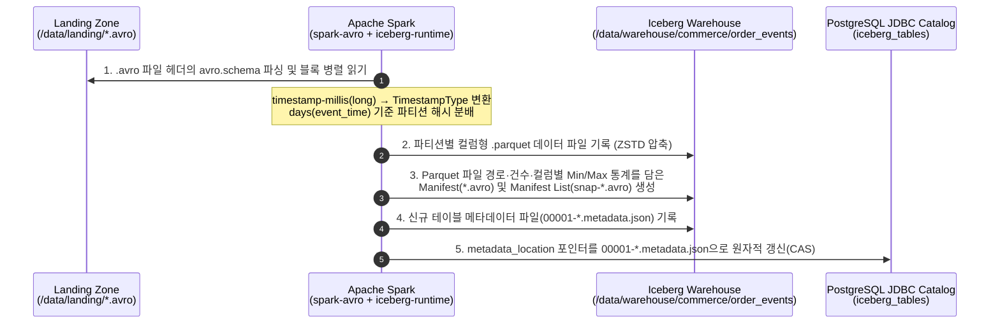

# [Chapter 3] Apache Spark로 Avro 파일을 읽어 Iceberg(Parquet) 테이블로 변환·적재

[Chapter 2](Avro_Iceberg_Trino_Ch2_Java_Avro_Writer.md)에서 Java 애플리케이션으로 `data/landing/orders_20261107.avro` 파일(총 5건: `2026-11-07` 3건, `2026-11-08` 2건)을 생성했다면, 세 번째 단계는 **Apache Spark에서 `spark-avro`로 `.avro` 파일을 읽어들여 물리 데이터 포맷이 Parquet(`write.format.default = 'parquet'`)인 Apache Iceberg 테이블에 적재**하는 것이다.

이 문서에서는 Spark가 행 기반 `.avro` 파일을 읽어 컬럼 기반 `.parquet` 파일과 Iceberg 메타데이터 트리로 변환하는 내부 과정을 살펴보고, 히든 파티셔닝(`days(event_time)`)이 적용된 Iceberg v2 테이블 생성부터 초기 적재(`append`), 중복 방지 업서트(`MERGE INTO`), 그리고 생성된 물리 파일 검증까지 다룬다.

---

## 1. Spark의 Avro → Iceberg(Parquet) 변환 내부 흐름

Spark에서 `.avro` 파일을 읽어 Iceberg 테이블에 쓰는 과정은 단순한 파일 포맷 변환을 넘어 **파티션 분류, 컬럼 통계 수집, 스냅샷 원자적 커밋**이 한 번에 일어나는 트랜잭션 과정이다.



1. **스키마 자동 복원**: `spark.read.format("avro")`는 `.avro` 파일 헤더에 내장된 JSON 스키마를 읽어 별도의 스키마 지정 없이도 컬럼 이름과 타입을 복원한다. 특히 Chapter 1에서 정의한 `"logicalType": "timestamp-millis"`는 Spark의 `TimestampType`으로 자동 변환된다.
2. **컬럼형 Parquet 변환 및 통계 기록**: Iceberg Writer는 Spark DataFrame의 행들을 메모리에서 컬럼 청크(Row Group)로 재구성해 `.parquet` 파일로 내려쓰면서, 동시에 각 컬럼의 최솟값(`lower_bounds`)·최댓값(`upper_bounds`)·Null 개수를 계산해 Iceberg 매니페스트 파일에 기록한다.
3. **카탈로그 포인터 스왑**: 모든 `.parquet` 파일과 메타데이터 파일이 디스크에 안전하게 쓰인 뒤에야 PostgreSQL 카탈로그의 `metadata_location` 컬럼이 새 `metadata.json`을 가리키도록 업데이트된다. 따라서 적재 도중 작업이 실패하더라도 Trino 조회에는 불완전한 데이터가 절대 노출되지 않는다.

---

## 2. Iceberg 테이블 DDL 및 핵심 속성(`TBLPROPERTIES`) 설계

테이블을 생성할 때 어떤 속성을 지정하느냐에 따라 이후 파일 크기와 쿼리 성능이 크게 달라진다.

```sql
CREATE NAMESPACE IF NOT EXISTS lakehouse.commerce;

CREATE TABLE IF NOT EXISTS lakehouse.commerce.order_events (
    event_id      STRING    COMMENT '이벤트 고유 ID (UUID)',
    order_id      BIGINT    COMMENT '주문 번호',
    user_id       STRING    COMMENT '주문 고객 ID',
    order_status  STRING    COMMENT '주문 상태 (CREATED, PAID, CANCELLED)',
    total_amount  BIGINT    COMMENT '총 결제 금액 (원화 정수)',
    coupon_code   STRING    COMMENT '할인 쿠폰 코드 (선택)',
    event_time    TIMESTAMP COMMENT '이벤트 발생 시각 (UTC)'
)
USING iceberg
PARTITIONED BY (days(event_time))
TBLPROPERTIES (
    'format-version' = '2',
    'write.format.default' = 'parquet',
    'write.parquet.compression-codec' = 'zstd',
    'write.distribution-mode' = 'hash',
    'write.metadata.delete-after-commit.enabled' = 'true',
    'write.metadata.previous-versions-max' = '10'
);
```

### 주요 설정 항목 해설

* **`PARTITIONED BY (days(event_time))` (히든 파티셔닝)**:
  * 기존 Hive 테이블처럼 `event_date STRING` 같은 파생 파티션 컬럼을 테이블에 따로 추가할 필요가 없다.
  * 애플리케이션과 사용자는 원본 `event_time`(`TIMESTAMP`) 컬럼만 다루고, Iceberg가 내부적으로 일자 단위(`event_time_day=2026-11-07`)로 디렉터리와 매니페스트를 분할한다.
* **`'format-version' = '2'`**:
  * Iceberg v2 포맷을 활성화해 전체 Parquet 파일을 다시 쓰지 않고도 특정 행만 수정·삭제하는 Row-level Updates(`MERGE INTO`, `DELETE`, `UPDATE`)를 사용할 수 있게 한다.
* **`'write.format.default' = 'parquet'` & `'write.parquet.compression-codec' = 'zstd'`**:
  * 테이블의 기본 물리 데이터 파일 포맷을 Parquet로 지정하고, Snappy보다 압축률이 높으면서 읽기/쓰기 속도가 빠른 **Zstandard(`zstd`)** 코덱을 적용한다.
* **`'write.distribution-mode' = 'hash'`**:
  * Spark Executor들이 Parquet 파일을 쓰기 전에 파티션 키(`days(event_time)`)를 기준으로 데이터를 해시 셔플(Shuffle)해 모은 뒤 기록한다. 이 옵션이 없으면 모든 Task마다 각 날짜 파티션의 작은 Parquet 파일을 개별 생성해 소파일(Small Files)이 급증한다.

---

## 3. PySpark 배치 적재 코드 (`avro_to_iceberg.py`)

[Chapter 1](Avro_Iceberg_Trino_Ch1_Schema_and_Infra.md)에서 `spark/spark-defaults.conf`에 이미 `lakehouse` 카탈로그와 `spark-avro`, `iceberg-spark-runtime` 패키지를 설정해 두었으므로 PySpark 코드는 비즈니스 변환과 적재에만 집중할 수 있다.

### 1) 초기 적재 (`writeTo(...).append()`)

```python
from pyspark.sql import SparkSession
from pyspark.sql.functions import col

spark = (
    SparkSession.builder
    .appName("Chapter3-AvroToIcebergParquet")
    .getOrCreate()
)

# 1. Chapter 2에서 Java가 생성한 .avro 컨테이너 파일 로드
avro_path = "/data/landing/orders_20261107.avro"
raw_df = spark.read.format("avro").load(avro_path)

print("=== 1. Avro 파일에서 복원된 Spark DataFrame 스키마 ===")
raw_df.printSchema()

# 2. Iceberg 테이블 생성 (존재하지 않을 경우)
spark.sql("""
CREATE NAMESPACE IF NOT EXISTS lakehouse.commerce
""")

spark.sql("""
CREATE TABLE IF NOT EXISTS lakehouse.commerce.order_events (
    event_id      STRING,
    order_id      BIGINT,
    user_id       STRING,
    order_status  STRING,
    total_amount  BIGINT,
    coupon_code   STRING,
    event_time    TIMESTAMP
)
USING iceberg
PARTITIONED BY (days(event_time))
TBLPROPERTIES (
    'format-version' = '2',
    'write.format.default' = 'parquet',
    'write.parquet.compression-codec' = 'zstd',
    'write.distribution-mode' = 'hash'
)
""")

# 3. 컬럼 순서 및 타입 정렬 후 Iceberg 테이블에 Append
# (Avro logicalType timestamp-millis는 이미 TimestampType으로 읽히지만 명시적으로 cast하여 안전성 확보)
cleaned_df = raw_df.select(
    col("event_id"),
    col("order_id"),
    col("user_id"),
    col("order_status"),
    col("total_amount"),
    col("coupon_code"),
    col("event_time").cast("timestamp").alias("event_time"),
)

cleaned_df.writeTo("lakehouse.commerce.order_events").append()

print("=== 2. Iceberg 테이블 적재 완료 후 건수 확인 ===")
spark.sql("""
SELECT order_id, user_id, order_status, total_amount, coupon_code, event_time
FROM lakehouse.commerce.order_events
ORDER BY order_id
""").show(truncate=False)
```

### 2) 실무 권장 패턴: 재실행 시 중복 적재를 막는 `MERGE INTO` (멱등성 보장)

배치 잡이 장애로 재실행될 때 동일한 `.avro` 파일을 단순 `append()`하면 데이터가 중복 적재된다. Iceberg v2 테이블에서는 `event_id`를 기준으로 `MERGE INTO`를 수행해 **멱등성(Idempotency)**을 보장할 수 있다.

```python
# 읽어들인 Avro DataFrame을 임시 뷰로 등록
cleaned_df.createOrReplaceTempView("incoming_order_events")

# event_id가 이미 존재하면 건너뛰고(또는 상태 업데이트), 없을 때만 INSERT
spark.sql("""
MERGE INTO lakehouse.commerce.order_events AS target
USING incoming_order_events AS source
ON target.event_id = source.event_id
WHEN MATCHED THEN
    UPDATE SET
        target.order_status = source.order_status,
        target.total_amount = source.total_amount,
        target.coupon_code  = source.coupon_code,
        target.event_time   = source.event_time
WHEN NOT MATCHED THEN
    INSERT (event_id, order_id, user_id, order_status, total_amount, coupon_code, event_time)
    VALUES (source.event_id, source.order_id, source.user_id, source.order_status, source.total_amount, source.coupon_code, source.event_time)
""")
```

---

## 4. Java Spark (`Dataset<Row>`)로 변환·적재하는 경우

배치 애플리케이션까지 모두 Java로 통일하고 싶다면 Spark의 Java API(`DataFrameWriterV2`)로도 완전히 동일하게 작성할 수 있다.

```java
package com.example.pipeline.spark;

import org.apache.spark.sql.Dataset;
import org.apache.spark.sql.Row;
import org.apache.spark.sql.SparkSession;
import org.apache.spark.sql.functions;

public class SparkAvroToIcebergJob {

    public static void main(String[] args) throws Exception {
        SparkSession spark = SparkSession.builder()
                .appName("JavaSparkAvroToIceberg")
                .getOrCreate();

        Dataset<Row> avroDf = spark.read()
                .format("avro")
                .load("/data/landing/orders_20261107.avro");

        Dataset<Row> formattedDf = avroDf.select(
                functions.col("event_id"),
                functions.col("order_id"),
                functions.col("user_id"),
                functions.col("order_status"),
                functions.col("total_amount"),
                functions.col("coupon_code"),
                functions.col("event_time").cast("timestamp").alias("event_time")
        );

        formattedDf.writeTo("lakehouse.commerce.order_events").append();
        spark.stop();
    }
}
```

---

## 5. Chapter 3 완료 검증: 생성된 물리 Parquet 파일과 메타데이터 구조 확인

Spark 컨테이너에서 `avro_to_iceberg.py`를 실행한 뒤, 실제로 `/data/warehouse` 아래에 어떤 파일들이 만들어졌는지 확인한다.

### Step 1. Spark 잡 실행

```bash
docker exec -it spark-iceberg /opt/spark/bin/spark-submit /data/landing/avro_to_iceberg.py
```

실행 로그에 아래와 같이 `event_time`이 `timestamp` 타입으로 출력되고 5건이 조회되면 정상이다.

```text
=== 1. Avro 파일에서 복원된 Spark DataFrame 스키마 ===
root
 |-- event_id: string (nullable = true)
 |-- order_id: long (nullable = true)
 |-- user_id: string (nullable = true)
 |-- order_status: string (nullable = true)
 |-- total_amount: long (nullable = true)
 |-- coupon_code: string (nullable = true)
 |-- event_time: timestamp (nullable = true)

=== 2. Iceberg 테이블 적재 완료 후 건수 확인 ===
+--------+---------+------------+------------+-----------+-------------------+
|order_id|user_id  |order_status|total_amount|coupon_code|event_time         |
+--------+---------+------------+------------+-----------+-------------------+
|10001   |user-kim |PAID        |45000       |WELCOME10  |2026-11-07 01:10:00|
|10002   |user-lee |CREATED     |128000      |NULL       |2026-11-07 01:15:30|
|10003   |user-park|PAID        |89000       |VIP20      |2026-11-07 02:05:10|
|10004   |user-choi|CANCELLED   |32000       |NULL       |2026-11-08 00:20:00|
|10005   |user-kim |PAID        |64000       |REPEAT5    |2026-11-08 03:45:00|
+--------+---------+------------+------------+-----------+-------------------+
```

### Step 2. Warehouse 디렉터리 트리 확인

Chapter 2에서 넣은 5건의 데이터는 `2026-11-07` 3건과 `2026-11-08` 2건으로 구성되어 있으므로, `days(event_time)` 히든 파티셔닝에 의해 **`data/` 하위 디렉터리가 날짜별로 딱 2개 생성되고 각각 `.parquet` 파일이 저장**된 것을 확인할 수 있다.

```bash
tree data/warehouse/commerce/order_events
```

```text
data/warehouse/commerce/order_events
├── data
│   ├── event_time_day=2026-11-07
│   │   └── 00000-0-4a8c1f20-0001.parquet   <-- 2026-11-07 이벤트 3건이 저장된 Parquet 파일
│   └── event_time_day=2026-11-08
│       └── 00001-1-4a8c1f20-0001.parquet   <-- 2026-11-08 이벤트 2건이 저장된 Parquet 파일
└── metadata
    ├── 00000-1122aabb.metadata.json        <-- CREATE TABLE 시점 메타데이터 (스냅샷 없음)
    ├── 00001-3344ccdd.metadata.json        <-- append() 커밋 후 최신 테이블 메타데이터
    ├── snap-7890123456-1-9988.avro         <-- 스냅샷 #1의 매니페스트 리스트
    └── 9988-m0.avro                        <-- 위 Parquet 파일 2개의 경로·건수·통계를 담은 매니페스트
```

---

## 6. 관련 문서 및 다음 단계

* **전체 파이프라인 로드맵**: [Java Avro 저장부터 Spark Iceberg(Parquet) 변환·Trino 조회까지의 파이프라인 설계](Avro_Spark_Iceberg_Trino_Pipeline_Plan.md)
* **이전 챕터 (Chapter 2)**: [[Chapter 2] Java에서 Apache Avro로 `.avro` 컨테이너 파일 생성 및 검증](Avro_Iceberg_Trino_Ch2_Java_Avro_Writer.md)
* **다음 챕터 (Chapter 4)**: [[Chapter 4] Trino에서 Iceberg 카탈로그 연결 및 Parquet 데이터·메타데이터 교차 검증](Avro_Iceberg_Trino_Ch4_Trino_Query_and_Metadata.md) — Trino에서 동일한 Iceberg 카탈로그로 `iceberg.commerce.order_events` 테이블을 즉시 조회하고, `$files`, `$partitions`, `$snapshots` 메타데이터 테이블로 Parquet 변환 결과와 파티션 프루닝을 교차 검증한다.
