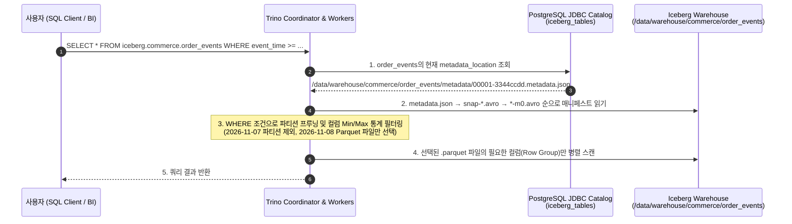

# [Chapter 4] Trino에서 Iceberg 카탈로그 연결 및 Parquet 데이터·메타데이터 교차 검증

[Chapter 3](Avro_Iceberg_Trino_Ch3_Spark_Avro_to_Iceberg.md)에서 Apache Spark가 `.avro` 파일을 읽어 `lakehouse.commerce.order_events` Iceberg 테이블(`data/*.parquet`)로 적재하고 스냅샷을 커밋했다면, 네 번째 단계는 **분산 SQL 쿼리 엔진인 Trino에서 별도의 메타스토어 동기화 없이 해당 테이블을 즉시 조회하고, Iceberg 메타데이터 테이블(`$files`, `$partitions`, `$snapshots`)로 Parquet 변환 결과를 교차 검증**하는 것이다.

이 문서에서는 Spark가 쓴 테이블을 Trino가 무중단으로 읽는 원리와 기본 분석 쿼리, 히든 파티셔닝 프루닝 확인, 그리고 메타데이터 테이블을 활용한 물리 파일 검증 방법을 정리한다.

---

## 1. 왜 Spark가 적재한 직후 Trino에서 별도 동기화 없이 바로 조회되는가?

기존 Hive 기반 데이터 레이크에서는 Spark가 새 날짜 디렉터리(`event_date=2026-11-08`)에 Parquet 파일을 쓰더라도 Hive Metastore에 파티션이 자동 등록되지 않아, Trino나 Presto에서 조회하기 전에 반드시 `MSCK REPAIR TABLE` 또는 `system.sync_partition_metadata()`를 실행해야 했다.

반면 Apache Iceberg에서는 **카탈로그 포인터와 매니페스트 트리**가 파티션 목록까지 모두 관리하므로 이 과정이 완전히 사라진다.



---

## 2. Trino CLI 접속 및 스키마·비즈니스 데이터 조회

[Chapter 1](Avro_Iceberg_Trino_Ch1_Schema_and_Infra.md)에서 `trino/catalog/iceberg.properties`를 마운트해 두었으므로 Trino CLI로 바로 접속해 `iceberg.commerce` 스키마를 조회한다.

```bash
docker exec -it trino-iceberg trino --catalog iceberg --schema commerce
```

### 1) 테이블 목록 및 컬럼 타입 매핑 확인 (`DESCRIBE`)

```sql
SHOW TABLES FROM iceberg.commerce;

DESCRIBE iceberg.commerce.order_events;
```

```text
    Column    |            Type             | Extra |       Comment
--------------+-----------------------------+-------+----------------------
 event_id     | varchar                     |       | 이벤트 고유 ID (UUID)
 order_id     | bigint                      |       | 주문 번호
 user_id      | varchar                     |       | 주문 고객 ID
 order_status | varchar                     |       | 주문 상태
 total_amount | bigint                      |       | 총 결제 금액
 coupon_code  | varchar                     |       | 할인 쿠폰 코드
 event_time   | timestamp(6) with time zone |       | 이벤트 발생 시각 (UTC)
```

Java Avro의 `{"type": "long", "logicalType": "timestamp-millis"}`가 Spark `TIMESTAMP`를 거쳐 Trino의 `timestamp(6) with time zone`으로 정확히 매핑된 것을 확인할 수 있다.

### 2) 전체 데이터 조회 및 상태별 집계 쿼리

```sql
-- 1. 전체 5건 주문 이벤트 조회
SELECT
    order_id,
    user_id,
    order_status,
    total_amount,
    coupon_code,
    event_time
FROM iceberg.commerce.order_events
ORDER BY order_id;
```

```text
 order_id |  user_id  | order_status | total_amount | coupon_code |          event_time
----------+-----------+--------------+--------------+-------------+-------------------------------
    10001 | user-kim  | PAID         |        45000 | WELCOME10   | 2026-11-07 01:10:00.000000 UTC
    10002 | user-lee  | CREATED      |       128000 | NULL        | 2026-11-07 01:15:30.000000 UTC
    10003 | user-park | PAID         |        89000 | VIP20       | 2026-11-07 02:05:10.000000 UTC
    10004 | user-choi | CANCELLED    |        32000 | NULL        | 2026-11-08 00:20:00.000000 UTC
    10005 | user-kim  | PAID         |        64000 | REPEAT5     | 2026-11-08 03:45:00.000000 UTC
(5 rows)
```

```sql
-- 2. 일자별·주문 상태별 건수 및 매출 합계 집계
SELECT
    date_trunc('day', event_time) AS order_day,
    order_status,
    count(*)                      AS event_cnt,
    sum(total_amount)             AS sum_amount
FROM iceberg.commerce.order_events
GROUP BY 1, 2
ORDER BY 1, 2;
```

---

## 3. 히든 파티셔닝(Hidden Partitioning) 동작 검증

테이블 생성 시 `PARTITIONED BY (days(event_time))`을 지정했으므로, 사용자는 별도의 파티션 컬럼 조건을 넣지 않고 원본 `event_time` 컬럼으로만 범위를 지정해도 Trino가 불필요한 일자 파티션(`2026-11-07`)의 Parquet 파일을 스캔 대상에서 완전히 제외한다.

```sql
SELECT
    order_id,
    user_id,
    order_status,
    total_amount,
    event_time
FROM iceberg.commerce.order_events
WHERE event_time >= TIMESTAMP '2026-11-08 00:00:00 UTC';
```

위 쿼리 앞에 `EXPLAIN ANALYZE`를 붙여 실행하면 `Input: 2 rows`로 표시되며, `event_time_day=2026-11-07` 디렉터리의 Parquet 파일(3건)은 아예 읽지 않고 `event_time_day=2026-11-08` 디렉터리의 Parquet 파일(2건)만 스캔한 것을 확인할 수 있다.

---

## 4. Iceberg 메타데이터 테이블로 Parquet 변환 결과 교차 검증

Trino의 Iceberg 커넥터는 테이블 이름 뒤에 `$files`, `$partitions`, `$snapshots`, `$history`를 붙여 **Iceberg 내부 메타데이터를 일반 SQL 테이블처럼 조회**하는 기능을 제공한다.

### 1) `"order_events$files"` — 물리 Parquet 파일 포맷 및 레코드 수 검증

Spark가 실제로 데이터를 `PARQUET` 포맷으로 변환해 저장했는지, 파일별 레코드 수와 바이트 크기가 얼마인지 확인한다.

```sql
SELECT
    content,
    file_format,
    partition,
    record_count,
    file_size_in_bytes,
    file_path
FROM iceberg.commerce."order_events$files"
ORDER BY record_count DESC;
```

```text
 content | file_format |       partition       | record_count | file_size_in_bytes |                                         file_path
---------+-------------+-----------------------+--------------+--------------------+-------------------------------------------------------------------------------------------
       0 | PARQUET     | {event_time_day=2026-11-07} |            3 |               1842 | /data/warehouse/commerce/order_events/data/event_time_day=2026-11-07/00000-0-...parquet
       0 | PARQUET     | {event_time_day=2026-11-08} |            2 |               1765 | /data/warehouse/commerce/order_events/data/event_time_day=2026-11-08/00001-1-...parquet
(2 rows)
```

* **`content = 0`**: 일반 데이터 파일(`DATA`)임을 의미한다. (Iceberg v2에서 Row-level 삭제 발생 시 생성되는 Position Delete 파일은 `1`, Equality Delete 파일은 `2`로 표시된다.)
* **`file_format = 'PARQUET'`**: Chapter 2의 `.avro` 파일이 Spark를 거치며 완벽히 컬럼형 `PARQUET` 데이터 파일로 변환되었음을 증명한다.
* **`record_count`**: `2026-11-07` 파티션에 3건, `2026-11-08` 파티션에 2건으로 총 5건이 정확히 일치한다.

### 2) `"order_events$partitions"` — 파티션별 요약 통계 확인

```sql
SELECT
    partition,
    record_count,
    file_count,
    total_size
FROM iceberg.commerce."order_events$partitions";
```

### 3) `"order_events$snapshots"` 및 타임 트래블(Time Travel) 조회

테이블에 발생한 모든 커밋 이력과 스냅샷 ID를 조회하고, 특정 시점의 스냅샷으로 데이터를 조회할 수 있다.

```sql
-- 1. 스냅샷 커밋 이력 조회
SELECT
    committed_at,
    snapshot_id,
    operation,
    summary['added-data-files'] AS added_files,
    summary['added-records']    AS added_records,
    summary['total-records']    AS total_records
FROM iceberg.commerce."order_events$snapshots"
ORDER BY committed_at DESC;

-- 2. 특정 스냅샷 ID 기준 타임 트래블 쿼리
SELECT *
FROM iceberg.commerce.order_events FOR VERSION AS OF 7890123456;
```

---

## 5. 자주 겪는 Spark ↔ Trino 연동 트러블슈팅 정리

| 증상 / 에러 메시지 | 원인 | 해결 방법 |
| :--- | :--- | :--- |
| Trino에서 `SHOW TABLES`에는 테이블이 보이지만 `SELECT` 시 `FileNotFoundException: /data/warehouse/...parquet` 발생 | Spark 컨테이너와 Trino 컨테이너의 호스트 볼륨 마운트 경로가 서로 다름 | `docker-compose.yml`에서 두 컨테이너 모두 동일하게 `./data/warehouse:/data/warehouse`로 마운트 |
| Trino 기동 실패 또는 쿼리 시 `Native local file system is disabled` 에러 발생 | 최신 Trino Iceberg 커넥터는 보안상 로컬 파일시스템 접근을 기본 비활성화함 | `trino/catalog/iceberg.properties`에 `fs.native-local.enabled=true` 및 `local.location=/data/warehouse` 추가 |
| Java에서 넣은 UTC 시각과 Spark/Trino 조회 시각이 9시간(`Asia/Seoul`) 차이 남 | Spark 세션 타임존이 로컬 OS 타임존(`KST`)으로 동작해 Timestamp 해석이 어긋남 | `spark-defaults.conf`에 `spark.sql.session.timeZone=UTC`를 명시해 전 구간 UTC 기준으로 통일 |

---

## 6. 관련 문서 및 다음 단계

* **전체 파이프라인 로드맵**: [Java Avro 저장부터 Spark Iceberg(Parquet) 변환·Trino 조회까지의 파이프라인 설계](Avro_Spark_Iceberg_Trino_Pipeline_Plan.md)
* **이전 챕터 (Chapter 3)**: [[Chapter 3] Apache Spark로 Avro 파일을 읽어 Iceberg(Parquet) 테이블로 변환·적재](Avro_Iceberg_Trino_Ch3_Spark_Avro_to_Iceberg.md)
* **다음 챕터 (Chapter 5)**: [[Chapter 5] 운영 고도화 — 스키마 진화(Schema Evolution), 소파일 Compaction, 스냅샷 만료](Avro_Iceberg_Trino_Ch5_Schema_Evolution_and_Maintenance.md) — Java Avro 스키마에 신규 컬럼(`payment_method`)이 추가되었을 때 기존 Parquet 데이터 재작성 없이 Spark·Iceberg·Trino에 반영하는 **스키마 진화**와 **소파일 Compaction·스냅샷 만료**를 실습한다.
