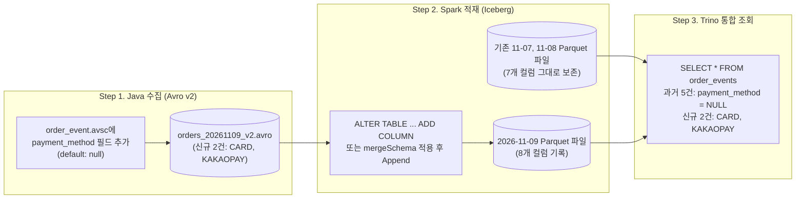

# [Chapter 5] 운영 고도화 — 스키마 진화(Schema Evolution), 소파일 Compaction, 스냅샷 만료

[Chapter 1](Avro_Iceberg_Trino_Ch1_Schema_and_Infra.md)부터 [Chapter 4](Avro_Iceberg_Trino_Ch4_Trino_Query_and_Metadata.md)까지 진행하며 **Java Avro 파일 생성 → Spark Iceberg(Parquet) 변환·적재 → Trino SQL 조회**로 이어지는 엔드투엔드 파이프라인을 완성했다. 마지막 다섯 번째 단계는 파이프라인을 실제 운영 환경에서 장기 운영할 때 반드시 마주치는 두 가지 과제인 **1) 무중단 스키마 진화(Schema Evolution)**와 **2) 소파일(Small Files) Compaction 및 구버전 스냅샷·고아 파일 정리**를 다루는 것이다.

---

## 1. End-to-End 무중단 스키마 진화(Schema Evolution) 실습

서비스 운영 중 **"주문 이벤트에 결제 수단(`payment_method`: `CARD`, `KAKAOPAY`, `NAVERPAY` 등) 컬럼을 추가해야 한다"**는 요구사항이 생겼다고 가정한다. Avro와 Iceberg를 조합하면 **과거에 이미 적재된 Parquet 파일들을 단 한 바이트도 다시 쓰지 않고** 전 구간 스키마를 확장할 수 있다.



### 왜 기존 Parquet 파일을 다시 쓰지 않아도 안전한가? (Iceberg 고유 Column ID)

Hive 테이블은 컬럼을 **이름(Name)**이나 **위치(Position)** 기준으로 매핑하기 때문에 중간에 컬럼을 추가·삭제하거나 이름을 바꾸면 기존 파일의 컬럼이 밀리거나 깨지는 문제가 발생했다. 반면 Apache Iceberg는 `metadata.json` 안에서 모든 컬럼에 **불변의 고유 정수 ID(`field-id`: 1, 2, 3...)**를 부여해 추적한다.

* 새로 추가된 `payment_method` 컬럼에는 새 ID(`field-id = 8`)가 부여된다.
* Trino가 과거(`2026-11-07`, `2026-11-08`) Parquet 파일을 읽을 때 파일 내부에 `field-id = 8`이 없으면 에러를 내는 대신 자동으로 `NULL`을 채워 반환한다.

---

### Step 1. Java Avro 스키마(v2) 업데이트 및 신규 `.avro` 파일 생성

`schemas/order_event.avsc` 맨 아래에 `payment_method` 필드를 추가한다. 하위/상위 호환성을 위해 반드시 `["null", "string"]` 타입과 `"default": null`을 함께 지정한다.

```json
    {
      "name": "event_time",
      "type": {
        "type": "long",
        "logicalType": "timestamp-millis"
      },
      "doc": "이벤트 발생 시각 (UTC Epoch Milliseconds)"
    },
    {
      "name": "payment_method",
      "type": ["null", "string"],
      "default": null,
      "doc": "결제 수단 (v2 신규 추가: CARD, KAKAOPAY 등)"
    }
```

이어서 Java에서 새 스키마로 `data/landing/orders_20261109_v2.avro` 파일(신규 주문 2건)을 생성한다.

```java
GenericRecord v2Event1 = new GenericData.Record(schemaV2);
v2Event1.put("event_id", UUID.randomUUID().toString());
v2Event1.put("order_id", 10006L);
v2Event1.put("user_id", "user-han");
v2Event1.put("order_status", "PAID");
v2Event1.put("total_amount", 77000L);
v2Event1.put("coupon_code", null);
v2Event1.put("event_time", Instant.parse("2026-11-09T04:00:00Z").toEpochMilli());
v2Event1.put("payment_method", "KAKAOPAY");

GenericRecord v2Event2 = new GenericData.Record(schemaV2);
v2Event2.put("event_id", UUID.randomUUID().toString());
v2Event2.put("order_id", 10007L);
v2Event2.put("user_id", "user-song");
v2Event2.put("order_status", "PAID");
v2Event2.put("total_amount", 150000L);
v2Event2.put("coupon_code", "WINTER30");
v2Event2.put("event_time", Instant.parse("2026-11-09T05:30:00Z").toEpochMilli());
v2Event2.put("payment_method", "CARD");
```

---

### Step 2. Spark에서 Iceberg 테이블 스키마 확장 및 적재

Iceberg 테이블에 신규 컬럼을 반영하는 방법은 **1) 명시적 `ALTER TABLE` 방식(권장)**과 **2) `mergeSchema` 자동 병합 방식** 두 가지가 있다.

#### 방법 A: 명시적 DDL로 컬럼 추가 후 적재 (운영 환경 권장)
승인되지 않은 이상 컬럼이 테이블에 유입되는 것을 통제할 수 있어 운영 파이프라인에서 가장 안전한 방식이다.

```python
# 1. Iceberg 메타데이터에만 컬럼 추가 (실행 시간 1초 미만, 기존 데이터 파일 재작성 없음)
spark.sql("""
ALTER TABLE lakehouse.commerce.order_events
ADD COLUMN IF NOT EXISTS payment_method STRING COMMENT '결제 수단 (CARD, KAKAOPAY 등)'
""")

# 2. v2 Avro 파일 로드 및 Append
v2_df = spark.read.format("avro").load("/data/landing/orders_20261109_v2.avro")

(
    v2_df.select(
        col("event_id"),
        col("order_id"),
        col("user_id"),
        col("order_status"),
        col("total_amount"),
        col("coupon_code"),
        col("event_time").cast("timestamp").alias("event_time"),
        col("payment_method"),
    )
    .writeTo("lakehouse.commerce.order_events")
    .append()
)
```

#### 방법 B: `mergeSchema` 옵션으로 자동 스키마 진화
수집 파이프라인이 상위 Avro 스키마 변경을 자동으로 테이블에 반영하도록 구성하려면 테이블 속성 `'write.spark.accept-any-schema' = 'true'`를 켜고 `option("mergeSchema", "true")`로 적재한다.

```python
spark.sql("""
ALTER TABLE lakehouse.commerce.order_events
SET TBLPROPERTIES ('write.spark.accept-any-schema' = 'true')
""")

(
    v2_df.withColumn("event_time", col("event_time").cast("timestamp"))
    .writeTo("lakehouse.commerce.order_events")
    .option("mergeSchema", "true")
    .append()
)
```

---

### Step 3. Trino에서 과거 데이터(v1)와 신규 데이터(v2) 통합 조회 검증

Trino에서 다시 `order_events`를 조회하면 별도의 테이블 재생성 없이 과거 5건은 `payment_method`가 `NULL`로, 신규 2건은 `KAKAOPAY`와 `CARD`로 매끄럽게 조회된다.

```sql
SELECT
    order_id,
    user_id,
    order_status,
    total_amount,
    payment_method,
    event_time
FROM iceberg.commerce.order_events
ORDER BY order_id;
```

```text
 order_id |  user_id  | order_status | total_amount | payment_method |          event_time
----------+-----------+--------------+--------------+----------------+-------------------------------
    10001 | user-kim  | PAID         |        45000 | NULL           | 2026-11-07 01:10:00.000000 UTC
    10002 | user-lee  | CREATED      |       128000 | NULL           | 2026-11-07 01:15:30.000000 UTC
    10003 | user-park | PAID         |        89000 | NULL           | 2026-11-07 02:05:10.000000 UTC
    10004 | user-choi | CANCELLED    |        32000 | NULL           | 2026-11-08 00:20:00.000000 UTC
    10005 | user-kim  | PAID         |        64000 | NULL           | 2026-11-08 03:45:00.000000 UTC
    10006 | user-han  | PAID         |        77000 | KAKAOPAY       | 2026-11-09 04:00:00.000000 UTC
    10007 | user-song | PAID         |       150000 | CARD           | 2026-11-09 05:30:00.000000 UTC
(7 rows)
```

---

## 2. 소파일(Small Files) Compaction (`rewrite_data_files`)

Java 애플리케이션이 5분~10분 주기로 `.avro` 파일을 떨어뜨리고 Spark가 이를 주기적으로 `append()`하면, 하루에 한 파티션 안에만 수백 개의 작은 `.parquet` 파일이 쌓인다. 컬럼형 포맷인 Parquet는 파일 하나당 크기가 최소 **128MB ~ 512MB** 수준일 때 스캔 효율이 극대화되므로, 주기적으로 작은 파일들을 큰 파일로 병합하는 **Compaction** 작업을 수행해야 한다.

### 1) Spark Iceberg 시스템 프로시저로 Compaction 실행

```sql
-- 기본 binpack 전략으로 소파일들을 목표 크기(128MB) 단위로 병합
CALL lakehouse.system.rewrite_data_files(
    table => 'commerce.order_events',
    options => map(
        'target-file-size-bytes', '134217728',
        'min-input-files', '2'
    )
);
```

### 2) 자주 조회하는 조건 컬럼 기준 정렬 병합 (`sort` 전략)

Trino에서 특정 고객(`user_id`)이나 주문 번호(`order_id`)로 조회하는 빈도가 높다면, 단순 병합(`binpack`) 대신 **`sort` 전략**으로 Parquet 파일을 재작성한다. 같은 `user_id` 값들이 특정 Parquet 파일과 Row Group에 모이게 되어 Parquet 푸터의 Min/Max 통계 기반 **Data Skipping 효과**가 극대화된다.

```sql
CALL lakehouse.system.rewrite_data_files(
    table => 'commerce.order_events',
    strategy => 'sort',
    sort_order => 'user_id ASC NULLS LAST, order_id ASC NULLS LAST',
    options => map('rewrite-all', 'true')
);
```

> [!NOTE]
> Trino에서도 `ALTER TABLE iceberg.commerce.order_events EXECUTE optimize(file_size_threshold => '100MB');` 명령어로 간단한 파일 병합을 수행할 수 있다. 다만 대규모 테이블의 정렬(`sort` / `zorder`) 기반 Compaction은 Spark의 `rewrite_data_files` 프로시저가 훨씬 세밀한 옵션을 제공한다.

---

## 3. 구버전 스냅샷 만료(`expire_snapshots`) 및 고아 파일 정리

`rewrite_data_files`로 소파일들을 1개의 큰 Parquet 파일로 합치더라도, **디스크(`data/warehouse`)를 열어보면 합쳐지기 전의 작은 Parquet 파일들이 그대로 남아 있다.** 이는 과거 스냅샷을 기준으로 타임 트래블 쿼리를 실행하거나 실행 중이던 Trino 쿼리가 읽고 있을 수 있기 때문이다.

스토리지 용량을 실제로 회수하려면 반드시 **스냅샷 만료(`expire_snapshots`)**를 주기적으로 실행해야 한다.

```sql
-- 1. 지정 시각 이전의 구버전 스냅샷을 만료시키고 더 이상 어떤 유효 스냅샷도 참조하지 않는 Parquet 파일 삭제
CALL lakehouse.system.expire_snapshots(
    table => 'commerce.order_events',
    older_than => TIMESTAMP '2026-11-10 00:00:00',
    retain_last => 5
);

-- 2. 작업 도중 컨테이너 강제 종료 등으로 카탈로그에 등록되지 못한 고아(Orphan) 파일 정리
CALL lakehouse.system.remove_orphan_files(
    table => 'commerce.order_events',
    older_than => TIMESTAMP '2026-11-08 00:00:00'
);

-- 3. 조각난 매니페스트(*.avro) 파일들도 하나로 병합하여 Trino 쿼리 플래닝 속도 개선
CALL lakehouse.system.rewrite_manifests('commerce.order_events');
```

> [!CAUTION]
> 운영 환경에서 `expire_snapshots`나 `remove_orphan_files`의 `older_than` 시각을 **현재 시각(`now()`)과 너무 가깝게 설정하면 절대 안 된다.** 특히 `remove_orphan_files`는 현재 Spark가 한창 쓰고 있어서 아직 카탈로그 커밋이 끝나지 않은 신규 `.parquet` 파일까지 고아 파일로 오인해 삭제할 수 있으므로, 최소 **24시간~72시간 이전 시각**을 기준으로 지정해야 한다.

스냅샷 만료 시 여러 스냅샷이 공유하는 Parquet 파일은 보존되고 만료된 스냅샷만 단독 참조하던 파일만 안전하게 삭제되는 메커니즘과 실측 결과는 [Iceberg snapshot 만료와 공유 파일 보존](Iceberg_Snapshot_Expiration_Lab.md) 문서에서 자세히 확인할 수 있다.

---

## 4. 전체 5개 챕터 파이프라인 운영 체크리스트 요약

| 단계 | 핵심 점검 항목 | 관련 챕터 문서 |
| :--- | :--- | :--- |
| **1. 스키마 & 인프라** | • 타임스탬프는 `logicalType: "timestamp-millis"` 사용<br/>• Nullable 필드는 `["null", "type"]` + `"default": null` 지정<br/>• Spark·Trino가 동일한 카탈로그 DB와 동일한 Warehouse 경로를 마운트했는가? | [Chapter 1](Avro_Iceberg_Trino_Ch1_Schema_and_Infra.md) |
| **2. Java Avro 수집** | • Avro `1.12.2+` 사용 (`AVRO-4183` 방지)<br/>• `avro-maven-plugin`에 `<stringType>String</stringType>` 적용<br/>• `DataFileWriter`에 `CodecFactory.snappyCodec()` 압축 적용 | [Chapter 2](Avro_Iceberg_Trino_Ch2_Java_Avro_Writer.md) |
| **3. Spark Iceberg 적재** | • `format-version = '2'`, `write.format.default = 'parquet'`, `zstd` 코덱 지정<br/>• `write.distribution-mode = 'hash'`로 파티션별 소파일 생성 억제<br/>• 재실행 멱등성을 위해 단순 `append` 대신 `MERGE INTO` 고려 | [Chapter 3](Avro_Iceberg_Trino_Ch3_Spark_Avro_to_Iceberg.md) |
| **4. Trino 조회 & 검증** | • 로컬 Warehouse 사용 시 `fs.native-local.enabled=true` 설정<br/>• `"$files"`, `"$partitions"`, `"$snapshots"` 메타데이터 테이블로 건수·포맷 교차 검증 | [Chapter 4](Avro_Iceberg_Trino_Ch4_Trino_Query_and_Metadata.md) |
| **5. 운영 유지보수** | • 컬럼 추가 시 `ALTER TABLE ... ADD COLUMN` 또는 `mergeSchema` 활용<br/>• 일/주 단위 `rewrite_data_files`, `expire_snapshots`, `rewrite_manifests` 스케줄링 | **현재 문서 (Chapter 5)** |

---

## 5. 관련 문서

* **전체 파이프라인 로드맵**: [Java Avro 저장부터 Spark Iceberg(Parquet) 변환·Trino 조회까지의 파이프라인 설계](Avro_Spark_Iceberg_Trino_Pipeline_Plan.md)
* **이전 챕터**:
  * [[Chapter 1] Avro 스키마 설계 및 Spark·Trino 로컬 레이크하우스 공통 인프라 구성](Avro_Iceberg_Trino_Ch1_Schema_and_Infra.md)
  * [[Chapter 2] Java에서 Apache Avro로 `.avro` 컨테이너 파일 생성 및 검증](Avro_Iceberg_Trino_Ch2_Java_Avro_Writer.md)
  * [[Chapter 3] Apache Spark로 Avro 파일을 읽어 Iceberg(Parquet) 테이블로 변환·적재](Avro_Iceberg_Trino_Ch3_Spark_Avro_to_Iceberg.md)
  * [[Chapter 4] Trino에서 Iceberg 카탈로그 연결 및 Parquet 데이터·메타데이터 교차 검증](Avro_Iceberg_Trino_Ch4_Trino_Query_and_Metadata.md)
* **심화 실측 사례**: [Iceberg snapshot 만료와 공유 파일 보존](Iceberg_Snapshot_Expiration_Lab.md)
