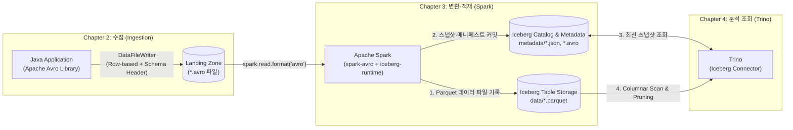

# Java Avro 저장부터 Spark Iceberg(Parquet) 변환·Trino 조회까지의 파이프라인 설계 및 챕터별 진행 계획

Java 애플리케이션에서 발생한 이벤트를 **Apache Avro(`.avro`)** 파일로 저장하고, **Apache Spark**로 읽어 **Apache Iceberg(Parquet 기반)** 테이블로 변환·적재한 뒤, **Trino**에서 SQL로 조회하는 흐름은 현대 데이터 레이크하우스(Lakehouse)의 가장 표준적인 수집·적재 패턴이다.

처음 이 파이프라인을 구축할 때 한 번에 모든 컴포넌트를 띄우면 스키마 불일치 문제인지, Spark 카탈로그 설정 문제인지, Trino의 스토리지 경로 권한 문제인지 원인을 분리하기 어렵다. 각 단계의 입출력을 독립적으로 검증할 수 있도록 **5개 챕터**로 나누어 진행하는 실행 계획과 단계별 핵심 예제 코드, 그리고 TIL 시리즈로 문서화하기 위한 템플릿을 정리한다.

---

## 1. 아키텍처와 포맷 역할 정리 ("Iceberg Parquet"의 정확한 의미)

파이프라인을 구현하기 전에 먼저 **"왜 처음부터 Parquet로 쓰지 않고 Avro로 저장한 뒤 Iceberg(Parquet)로 바꾸는가?"**와 **"Iceberg Parquet 형태란 정확히 무엇인가?"**를 명확히 구분해야 한다.



| 구분 | Apache Avro (`.avro`) | Apache Parquet (`.parquet`) | Apache Iceberg |
| :--- | :--- | :--- | :--- |
| **계층(Layer)** | 물리 파일 포맷 (Row 기반 컨테이너) | 물리 파일 포맷 (Column 기반 스토리지) | **테이블 포맷 (Table Metadata Layer)** |
| **저장 구조** | 행(Row) 단위 순차 기록 + **파일 헤더에 JSON 스키마 내장** | 열(Column) 단위 청크(Row Group) + 파일 푸터에 통계(Min/Max) 내장 | `metadata.json` → `manifest list` → `manifest file`로 실제 데이터 파일 목록과 스냅샷 관리 |
| **주 용도** | Java 애플리케이션의 건별/마이크로배치 직렬화, Kafka 메시지, Raw/Landing Zone 파일 저장 | 대규모 집계·필터링 분석 쿼리 (필요한 컬럼만 읽는 Projection, Predicate Pushdown) | ACID 트랜잭션, 타임 트래블, 스키마·파티션 진화, 다중 엔진(Spark·Trino) 동시성 제어 |
| **이 파이프라인에서의 역할** | **Java 수집 출력물**: 메모리 버퍼 오버헤드 없이 빠르게 행 단위로 Append하고 스키마를 파일 자체에 보존 | **Iceberg 내부 실제 데이터 파일**: Iceberg의 기본 저장 포맷(`write.format.default = 'parquet'`) | **Spark와 Trino의 매개체**: Spark가 쓴 Parquet 파일들을 테이블 스냅샷으로 묶어 Trino가 안전하게 읽도록 보장 |

> [!IMPORTANT]
> 흔히 말하는 **"Iceberg Parquet 형태로 변환한다"**는 표현은 **"데이터 자체는 컬럼형 `.parquet` 파일로 저장하되, 어떤 Parquet 파일이 현재 유효한지 관리하는 메타데이터와 트랜잭션은 Apache Iceberg 테이블 포맷으로 감싼다"**는 뜻이다. 흥미롭게도 Iceberg는 실제 데이터 파일은 `.parquet`로 저장하면서, 그 Parquet 파일들의 목록을 담는 매니페스트(Manifest) 메타데이터 파일은 `.avro` 포맷으로 저장한다.

---

## 2. 챕터별 진행 로드맵 요약

한 번에 전체를 붙이지 않고, 앞 단계의 산출물이 다음 단계의 입력이 되도록 **5개 챕터**로 나누어 실습과 문서화를 진행하는 것이 가장 효율적이다.

| 챕터 | 주제 | 핵심 작업 | 완료 검증 기준 (Definition of Done) | 권장 TIL 문서 제목(안) |
| :--- | :--- | :--- | :--- | :--- |
| **Chapter 1** | 스키마 설계 및 공통 인프라 구성 | Avro `.avsc` 스키마 정의, 공유 스토리지(Local/S3) 및 Iceberg 카탈로그(PostgreSQL JDBC/REST), Spark·Trino 컨테이너 설계 | `docker compose ps` 정상 기동 및 스키마 JSON 유효성 통과 | [Avro_Iceberg_Trino_Ch1_Schema_and_Infra.md](Avro_Iceberg_Trino_Ch1_Schema_and_Infra.md) |
| **Chapter 2** | Java에서 Apache Avro 파일 생성 및 검증 | Java `DataFileWriter`로 `.avro` 파일 생성(Snappy 압축), `DataFileReader`로 역직렬화 테스트 | 생성된 `.avro` 파일 헤더에서 스키마가 읽히고 건수가 일치함 | `02_Java_Apache_Avro_파일_직렬화_가이드.md` |
| **Chapter 3** | Spark로 Avro를 읽어 Iceberg(Parquet)로 변환 | `spark-avro`로 `.avro` 로드 후 Iceberg 테이블(`USING iceberg`)에 적재 | Warehouse 경로에 `data/*.parquet`와 `metadata/*.metadata.json` 생성 확인 | `03_Spark_Avro_to_Iceberg_Parquet_변환.md` |
| **Chapter 4** | Trino에서 Iceberg 카탈로그 연동 및 조회 | Trino `iceberg.properties` 설정 후 일반 쿼리 및 `$files`, `$snapshots` 메타데이터 조회 | Spark에서 적재한 건수·컬럼 타입이 Trino에서 동일하게 조회됨 | `04_Trino_Iceberg_카탈로그_연동과_메타데이터_조회.md` |
| **Chapter 5** | 운영 심화: 스키마 진화·Compaction·스냅샷 만료 | Avro 컬럼 추가 후 파이프라인 재실행, 소파일 병합(`rewrite_data_files`), 스냅샷 정리 | 기존 데이터 재작성 없이 신규 컬럼 조회 및 파일 수 감소 확인 | `05_Iceberg_스키마_진화와_운영_최적화.md` |

---

## 3. 챕터별 상세 진행 가이드 및 핵심 코드

### Chapter 1: 스키마 설계 및 로컬 레이크하우스 공통 인프라 구성

#### 1) 학습 및 구현 목표

* Java, Spark, Trino 세 환경에서 타입 충돌이 발생하지 않도록 **Avro 스키마(`.avsc`)**를 설계한다.
* Spark가 쓴 Iceberg 테이블을 Trino가 즉시 읽으려면 **동일한 Iceberg 카탈로그**와 **동일한 파일/오브젝트 스토리지 경로**를 바라봐야 한다는 점을 아키텍처로 잡는다.

#### 2) Avro 스키마 설계 (`src/main/resources/avro/order_event.avsc`)
타임스탬프는 단순 문자열 대신 Avro 논리 타입(`logicalType: "timestamp-millis"`)을 사용해야 Spark와 Iceberg에서 `TIMESTAMP(6) WITH TIME ZONE`으로 매핑하기 수월하다. 또한 향후 스키마 진화를 대비해 Nullable 필드에는 반드시 `"default": null`을 명시한다.

```json
{
  "type": "record",
  "name": "OrderEvent",
  "namespace": "com.example.pipeline.avro",
  "doc": "주문 이벤트 수집용 Avro 스키마",
  "fields": [
    { "name": "event_id", "type": "string", "doc": "이벤트 고유 ID (UUID)" },
    { "name": "order_id", "type": "long", "doc": "주문 번호" },
    { "name": "user_id", "type": "string", "doc": "주문 고객 ID" },
    { "name": "order_status", "type": "string", "doc": "CREATED | PAID | CANCELLED" },
    { "name": "total_amount", "type": "long", "doc": "결제 금액 (원화 정수)" },
    {
      "name": "coupon_code",
      "type": ["null", "string"],
      "default": null,
      "doc": "할인 쿠폰 코드 (선택)"
    },
    {
      "name": "event_time",
      "type": {
        "type": "long",
        "logicalType": "timestamp-millis"
      },
      "doc": "이벤트 발생 시각 (Epoch Millis)"
    }
  ]
}
```

> [!WARNING]
> Java 코드 생성기(`avro-maven-plugin` 등)를 사용할 때 Avro `1.12.1` 버전은 스키마에 `result`라는 필드명이 포함될 경우 `hashCode()` 지역 변수와 충돌해 컴파일 오류가 발생하는 버그(`AVRO-4183`)가 있다. 반드시 **Avro `1.12.2` 이상**을 사용한다. 자세한 원인은 [Avro result 필드와 hashCode 지역 변수 충돌](Avro_HashCode_Field_Naming_Conflict.md) 문서를 참고한다.

#### 3) Spark와 Trino의 공유 인프라 구성 원칙
로컬 Docker Compose로 실습할 때 가장 많이 겪는 실패 원인은 **Spark 컨테이너 내부의 로컬 경로(`/tmp/warehouse`)에만 테이블을 써서 Trino 컨테이너가 해당 파일을 찾지 못하는 문제**다. 다음 두 가지 방식 중 하나를 선택한다.

1. **가장 간단한 입문 구성 (Shared Volume + JDBC Catalog)**
   * 호스트의 `./data/landing`(Avro 저장소)과 `./data/warehouse`(Iceberg 저장소)를 Spark와 Trino 컨테이너 양쪽에 **동일한 절대 경로(`/data/warehouse`)**로 바인드 마운트한다.
   * PostgreSQL 컨테이너 1개를 띄워 Iceberg JDBC 카탈로그로 공유한다.
2. **실무형 구성 (MinIO/Garage S3 + REST/JDBC Catalog)**
   * S3 호환 오브젝트 스토리지(`s3://warehouse/`)를 두고 Spark와 Trino가 `S3FileIO`로 접근한다.

---

### Chapter 2: Java에서 Apache Avro 라이브러리로 `.avro` 파일 저장 및 검증

#### 1) 학습 및 구현 목표

* Java에서 Avro 레코드를 생성하는 두 가지 방식(**`SpecificRecord`** 코드 생성 방식 vs **`GenericRecord`** 동적 스키마 방식)의 차이를 이해한다.
* `DataFileWriter`를 사용해 스키마 헤더와 압축 코덱(`snappy`)이 포함된 `.avro` 컨테이너 파일을 디스크에 저장하고, `DataFileReader`로 다시 읽어 검증한다.

#### 2) Maven 의존성 (`pom.xml`)
```xml
<dependencies>
    <!-- Apache Avro 1.12.2 (AVRO-4183 패치 포함) -->
    <dependency>
        <groupId>org.apache.avro</groupId>
        <artifactId>avro</artifactId>
        <version>1.12.2</version>
    </dependency>
    <!-- Snappy 압축 코덱 사용 시 필요 -->
    <dependency>
        <groupId>org.xerial.snappy</groupId>
        <artifactId>snappy-java</artifactId>
        <version>1.1.10.7</version>
    </dependency>
</dependencies>
```

#### 3) Java `.avro` 파일 쓰기·읽기 예제 코드
별도의 코드 생성 플러그인 없이도 즉시 실행해 구조를 확인할 수 있는 `GenericRecord` + `DataFileWriter` 예제다. (실무 서비스에서는 `avro-maven-plugin`으로 `OrderEvent` 클래스를 생성해 `SpecificDatumWriter<OrderEvent>`를 사용하는 것이 컴파일 타임 타입 안전성 면에서 유리하다.)

```java
package com.example.pipeline;

import org.apache.avro.Schema;
import org.apache.avro.file.CodecFactory;
import org.apache.avro.file.DataFileReader;
import org.apache.avro.file.DataFileWriter;
import org.apache.avro.generic.GenericData;
import org.apache.avro.generic.GenericDatumReader;
import org.apache.avro.generic.GenericDatumWriter;
import org.apache.avro.generic.GenericRecord;
import org.apache.avro.io.DatumReader;
import org.apache.avro.io.DatumWriter;

import java.io.File;
import java.io.IOException;
import java.io.InputStream;
import java.nio.file.Files;
import java.nio.file.Path;
import java.time.Instant;
import java.util.List;
import java.util.UUID;

public class AvroOrderEventFileExample {

    public static void main(String[] args) throws IOException {
        // 1. 스키마 로드 (.avsc 파일)
        Schema schema;
        try (InputStream in = AvroOrderEventFileExample.class
                .getResourceAsStream("/avro/order_event.avsc")) {
            schema = new Schema.Parser().parse(in);
        }

        Path outputPath = Path.of("data/landing/orders_20261103.avro");
        Files.createDirectories(outputPath.getParent());
        File avroFile = outputPath.toFile();

        // 2. 샘플 레코드 생성
        GenericRecord event1 = new GenericData.Record(schema);
        event1.put("event_id", UUID.randomUUID().toString());
        event1.put("order_id", 10001L);
        event1.put("user_id", "user-kim");
        event1.put("order_status", "PAID");
        event1.put("total_amount", 45000L);
        event1.put("coupon_code", "WELCOME10");
        event1.put("event_time", Instant.parse("2026-11-03T07:15:00Z").toEpochMilli());

        GenericRecord event2 = new GenericData.Record(schema);
        event2.put("event_id", UUID.randomUUID().toString());
        event2.put("order_id", 10002L);
        event2.put("user_id", "user-lee");
        event2.put("order_status", "CREATED");
        event2.put("total_amount", 128000L);
        event2.put("coupon_code", null);
        event2.put("event_time", Instant.parse("2026-11-03T07:16:30Z").toEpochMilli());

        // 3. DataFileWriter로 .avro 컨테이너 파일 저장 (Snappy 압축 적용)
        DatumWriter<GenericRecord> datumWriter = new GenericDatumWriter<>(schema);
        try (DataFileWriter<GenericRecord> dataFileWriter = new DataFileWriter<>(datumWriter)) {
            dataFileWriter.setCodec(CodecFactory.snappyCodec());
            dataFileWriter.create(schema, avroFile);
            for (GenericRecord record : List.of(event1, event2)) {
                dataFileWriter.append(record);
            }
        }
        System.out.println("Avro 파일 생성 완료: " + avroFile.getAbsolutePath());

        // 4. DataFileReader로 파일 내부 스키마와 레코드 역직렬화 검증
        // 읽을 때는 스키마를 외부에서 주입하지 않아도 파일 헤더에 내장된 스키마로 읽을 수 있다.
        DatumReader<GenericRecord> datumReader = new GenericDatumReader<>();
        try (DataFileReader<GenericRecord> dataFileReader = new DataFileReader<>(avroFile, datumReader)) {
            System.out.println("내장된 Avro 스키마 이름: " + dataFileReader.getSchema().getFullName());
            GenericRecord record = null;
            while (dataFileReader.hasNext()) {
                record = dataFileReader.next(record); // 객체 재사용으로 GC 부담 감소
                System.out.printf("읽은 레코드 -> order_id=%d, status=%s, amount=%d%n",
                        record.get("order_id"),
                        record.get("order_status"),
                        record.get("total_amount"));
            }
        }
    }
}
```

#### 4) Chapter 2 완료 검증 체크리스트

* 생성된 `orders_20261103.avro` 파일의 첫 4바이트가 `Obj\x01`(Avro 컨테이너 파일 매직 헤더)로 시작하는가?
* 외부 `.avsc` 파일 없이 `new GenericDatumReader<>()`만으로도 파일 내장 스키마와 2건의 데이터가 정상 출력되는가?

---

### Chapter 3: Apache Spark로 Avro 파일을 읽어 Iceberg(Parquet) 테이블로 변환

#### 1) 학습 및 구현 목표

* Spark에서 기본 내장되지 않은 Avro 데이터소스를 사용하기 위해 `spark-avro` 패키지를 연결한다.
* Iceberg 카탈로그(`lakehouse`)를 설정하고, 물리 데이터 포맷이 **Parquet(`write.format.default = 'parquet'`)**인 Iceberg v2 테이블을 생성해 데이터를 적재한다.
* 적재 직후 Warehouse 디렉터리 내부에 생성된 `data/*.parquet` 파일과 `metadata/` 파일의 관계를 직접 확인한다.

#### 2) Spark 실행 명령어 및 패키지 구성
Spark 버전(예: Spark 3.5.x 또는 Spark 4.x)과 Scala 버전에 맞는 `spark-avro` 및 `iceberg-spark-runtime` JAR를 함께 로드한다.

```bash
spark-sql \
  --packages org.apache.spark:spark-avro_2.12:3.5.5,org.apache.iceberg:iceberg-spark-runtime-3.5_2.12:1.7.1,org.postgresql:postgresql:42.7.5 \
  --conf spark.sql.extensions=org.apache.iceberg.spark.extensions.IcebergSparkSessionExtensions \
  --conf spark.sql.catalog.lakehouse=org.apache.iceberg.spark.SparkCatalog \
  --conf spark.sql.catalog.lakehouse.type=jdbc \
  --conf spark.sql.catalog.lakehouse.uri=jdbc:postgresql://postgres:5432/iceberg_catalog \
  --conf spark.sql.catalog.lakehouse.jdbc.user=iceberg \
  --conf spark.sql.catalog.lakehouse.jdbc.password=iceberg \
  --conf spark.sql.catalog.lakehouse.warehouse=/data/warehouse
```

#### 3) Spark (PySpark / Scala) 변환 및 Iceberg 적재 코드
```python
from pyspark.sql import SparkSession
from pyspark.sql.functions import col

spark = SparkSession.builder.appName("AvroToIcebergParquet").getOrCreate()

# 1. Java가 생성한 .avro 파일 읽기
avro_df = spark.read.format("avro").load("/data/landing/orders_20261103.avro")

# 스키마 확인 (timestamp-millis 논리 타입이 TimestampType으로 자동 변환되었는지 확인)
avro_df.printSchema()

# 2. Iceberg 테이블 생성 (물리 포맷은 Parquet, 압축은 ZSTD 지정)
spark.sql("""
CREATE NAMESPACE IF NOT EXISTS lakehouse.commerce;
""")

spark.sql("""
CREATE TABLE IF NOT EXISTS lakehouse.commerce.order_events (
    event_id STRING,
    order_id BIGINT,
    user_id STRING,
    order_status STRING,
    total_amount BIGINT,
    coupon_code STRING,
    event_time TIMESTAMP
)
USING iceberg
PARTITIONED BY (days(event_time))
TBLPROPERTIES (
    'format-version' = '2',
    'write.format.default' = 'parquet',
    'write.parquet.compression-codec' = 'zstd'
)
""")

# 3. Avro DataFrame을 Iceberg 테이블에 Append (내부적으로 Parquet 파일이 생성됨)
(
    avro_df.select(
        col("event_id"),
        col("order_id"),
        col("user_id"),
        col("order_status"),
        col("total_amount"),
        col("coupon_code"),
        col("event_time").cast("timestamp").alias("event_time"),
    )
    .writeTo("lakehouse.commerce.order_events")
    .append()
)
```

> [!TIP]
> 만약 Avro의 `event_time`이 일반 `long` 타입(논리 타입 미지정)으로 저장되었다면 Spark에서 `(col("event_time") / 1000).cast("timestamp")`로 변환해 주어야 밀리초가 초 단위로 잘못 해석되는 문제를 막을 수 있다.

#### 4) Chapter 3 완료 검증 체크리스트
적재 후 `/data/warehouse/commerce/order_events/` 디렉터리 트리를 열어 다음 구조가 만들어졌는지 확인한다.

```text
/data/warehouse/commerce/order_events/
├── data/
│   └── event_time_day=2026-11-03/
│       └── 00000-0-xxxx-00001.parquet   <-- 실제 컬럼형 데이터 파일 (Parquet)
└── metadata/
    ├── 00000-xxxx.metadata.json         <-- 테이블 생성 시점 메타데이터
    ├── 00001-yyyy.metadata.json         <-- append 커밋 후 최신 메타데이터
    ├── snap-zzzz-1-wwww.avro            <-- 스냅샷 매니페스트 리스트
    └── wwww-m0.avro                     <-- Parquet 파일 경로와 컬럼 통계를 담은 매니페스트
```

---

### Chapter 4: Trino에서 Iceberg 카탈로그 연결 및 데이터·메타데이터 조회

#### 1) 학습 및 구현 목표

* Trino에 Iceberg 커넥터를 설정해 Spark가 바라보던 동일한 카탈로그와 Warehouse 경로를 연결한다.
* 비즈니스 데이터 조회뿐만 아니라 Iceberg 전용 메타데이터 테이블(`$snapshots`, `$files`)을 Trino에서 직접 쿼리해 Parquet 변환 결과를 교차 검증한다.

#### 2) Trino 카탈로그 설정 (`etc/catalog/iceberg.properties`)
```ini
connector.name=iceberg
iceberg.catalog.type=jdbc
iceberg.jdbc-catalog.driver-class=org.postgresql.Driver
iceberg.jdbc-catalog.connection-url=jdbc:postgresql://postgres:5432/iceberg_catalog
iceberg.jdbc-catalog.connection-user=iceberg
iceberg.jdbc-catalog.connection-password=iceberg
iceberg.jdbc-catalog.default-warehouse-dir=/data/warehouse
iceberg.file-format=PARQUET
```

#### 3) Trino 검증 SQL 쿼리
```sql
-- 1. 적재된 주문 이벤트 데이터 조회
SELECT
    order_id,
    user_id,
    order_status,
    total_amount,
    coupon_code,
    event_time
FROM iceberg.commerce.order_events
ORDER BY order_id;

-- 2. Iceberg가 실제로 Parquet 포맷으로 저장했는지 파일 메타데이터 테이블("$files")로 확인
SELECT
    content,
    file_format,
    record_count,
    file_size_in_bytes,
    file_path
FROM iceberg.commerce."order_events$files";

-- 3. 스냅샷 이력("$snapshots") 확인
SELECT
    committed_at,
    snapshot_id,
    operation,
    summary['added-data-files'] AS added_files,
    summary['added-records'] AS added_records
FROM iceberg.commerce."order_events$snapshots"
ORDER BY committed_at DESC;
```

#### 4) Chapter 4 완료 검증 체크리스트

* `SELECT * FROM iceberg.commerce."order_events$files"` 결과에서 `file_format` 컬럼 값이 **`PARQUET`**이고 `record_count`가 Java에서 생성한 레코드 수(`2`)와 정확히 일치하는가?

---

### Chapter 5: 운영 고도화 — 스키마 진화(Schema Evolution), Compaction, 스냅샷 만료

단순 적재 파이프라인이 동작하는 것을 확인했다면, 마지막 챕터에서는 레이크하우스를 도입하는 진짜 이유인 **스키마 진화**와 **파일 유지보수**를 실습한다.

1. **End-to-End 스키마 진화 실습**
   * **Java**: `order_event.avsc`에 `{ "name": "payment_method", "type": ["null", "string"], "default": null }` 필드를 추가해 새 `.avro` 파일을 생성한다.
   * **Spark**: `ALTER TABLE lakehouse.commerce.order_events ADD COLUMN payment_method STRING` 실행(또는 `mergeSchema` 옵션 활성화) 후 새 `.avro` 파일을 Append한다.
   * **Trino**: 기존 Parquet 파일을 다시 쓰지 않고도 과거 레코드는 `payment_method = NULL`, 신규 레코드는 정상 값으로 함께 조회되는지 확인한다.
2. **소파일(Small Files) Compaction 및 스냅샷 만료**
   * 마이크로배치로 `.avro` 파일을 자주 적재하면 작은 `.parquet` 파일이 수백 개 생겨 Trino 조회 성능이 저하된다.
   * Spark의 `CALL lakehouse.system.rewrite_data_files(table => 'commerce.order_events')`로 파일들을 병합하고, `CALL lakehouse.system.expire_snapshots(...)`로 구버전 스냅샷과 고아 파일을 정리한다.
   * 스냅샷 만료 시 공유 데이터 파일이 어떻게 보존·삭제되는지에 대한 실측 검증은 [Iceberg snapshot 만료와 공유 파일 보존](Iceberg_Snapshot_Expiration_Lab.md) 문서를 함께 참고한다.

---

## 4. TIL 문서 업로드 전략 및 챕터별 템플릿

이 파이프라인을 직접 실습하면서 TIL 저장소에 기록할 때는 다음과 같은 방식으로 문서를 구성하는 것을 권장한다.

### 1) 문서 배치 구조 (`docs/Data/`)

* **현재 문서 (`Avro_Spark_Iceberg_Trino_Pipeline_Plan.md`)**: 전체 아키텍처와 5개 챕터의 설계도(허브 문서) 역할을 한다.
* 실습을 진행하면서 각 챕터의 실행 로그나 트러블슈팅이 길어지면 아래처럼 개별 문서로 분리하거나, 본 문서의 각 챕터 섹션 아래에 실측 결과를 보강한다.
  * `docs/Data/Avro_Java_Serialization_Lab.md` (Chapter 2 실습 기록)
  * `docs/Data/Spark_Avro_to_Iceberg_Lab.md` (Chapter 3~4 실습 기록)

### 2) 챕터별 실습 기록 작성 템플릿
각 챕터를 직접 돌려본 뒤 결과를 문서화할 때는 아래 구성을 복사해 채워 넣으면 재현 가능한 기술 문서가 된다.

```markdown
# [Chapter N] 제목 (예: Spark로 Avro 파일을 읽어 Iceberg Parquet 테이블 적재하기)

한 줄 요약: 어떤 입력(`.avro`)을 받아 어떤 설정으로 처리해 어떤 결과(`Iceberg Parquet`)를 확인했는지 핵심부터 작성한다.

## 1. 실험 환경 및 버전
* **Java / Avro**: OpenJDK 21, Apache Avro 1.12.2
* **Spark / Iceberg**: Apache Spark x.x.x, Apache Iceberg x.x.x
* **Trino / Catalog**: Trino xxx, PostgreSQL JDBC Catalog

## 2. 핵심 설정 및 실행 코드
(실제 실행한 코드 블록 또는 SQL)

## 3. 실행 결과 및 산출물 검증
* 생성된 물리 파일 목록 (`ls -lh` 또는 `$files` 메타데이터 조회 결과)
* 기대한 동작과 실제 출력 비교

## 4. 트러블슈팅 메모 (발생 시)
* **증상 / 에러 메시지**:
* **원인**:
* **해결 방법**:
```

---

## 5. 관련 문서

* [Avro result 필드와 hashCode 지역 변수 충돌](Avro_HashCode_Field_Naming_Conflict.md) — Java에서 Avro 스키마 코드 생성 시 `1.12.2` 이상을 써야 하는 이유
* [Iceberg snapshot 만료와 공유 파일 보존](Iceberg_Snapshot_Expiration_Lab.md) — Spark와 Trino 환경에서 Iceberg 스냅샷 만료 후 물리 Parquet 파일과 메타데이터 변화를 실측한 사례
* [MinIO 분산 오브젝트 스토리지 가이드](../Infrastructure/MinIO/README.md) — 로컬 S3 호환 Warehouse 스토리지 구성 참고
