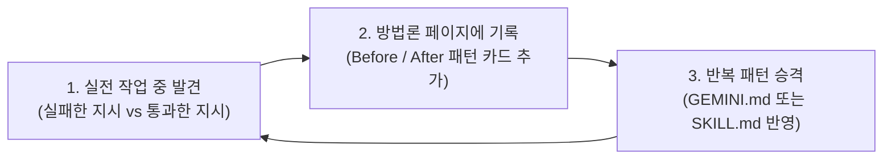

# AI 명령 설계(Prompting · Context · Harness) 방법론 및 주기적 운영 가이드

AI 코딩 에이전트와 LLM에게 원하는 결과를 한 번에 얻어내는 핵심은 문장을 화려하게 다듬는 것이 아니라, **모호함을 제거한 맥락(Context)과 스스로 정답을 확인하게 만드는 검증 장치(Harness)를 함께 전달하는 것**이다. 이 문서는 AI에게 명령을 내리는 실전 방법론과, 이를 일회성 메모로 끝내지 않고 주기적으로 갱신·자산화하는 운영 방식을 다룬다.

## 1. 어디서 운영할 것인가: TIL 내부 섹션 vs 별도 프로젝트 비교

결론부터 정리하면 **방법론 문서와 프롬프트 사례집은 현재 `TIL` 저장소(`docs/LLM_Development/`) 안에서 통합 운영하는 편이 유리**하다. 반면 여러 코드 저장소에 공통으로 배포할 에이전트 실행 스크립트나 스킬 파일(`SKILL.md`)만 필요할 때 별도 저장소로 분리한다.

| 비교 기준 | `TIL` 내부 섹션으로 운영 (**권장**) | 별도 프로젝트(저장소)로 분리 | 하이브리드 (TIL 문서화 + 실행 스킬만 분리) |
| :--- | :--- | :--- | :--- |
| **기록 마찰 (Friction)** | 낮음. 기술 학습·트러블슈팅 문서를 쓰면서 같은 워크플로우(`publish.sh`)로 즉시 기록 가능 | 높음. 작업 도중 다른 저장소를 열고 커밋·배포해야 하므로 업데이트가 쉽게 끊김 | 문서는 TIL에 빠르게 적고, 검증된 규칙만 스킬 저장소로 승격 |
| **기존 지식과의 연결** | 높음. Java, K8s, DB 트러블슈팅 사례나 모델 비교 문서와 내부 링크로 바로 연결 가능 | 낮음. 도메인 지식(TIL)과 프롬프트 방법론이 분리되어 맥락이 끊김 | 도메인 맥락은 TIL에서 유지하고, 도구 설정만 외부에서 참조 |
| **자동화·검증 인프라** | 이미 구축됨 (`mkdocs build --strict`, `Recent_Changes.md`, `Sitemap.md`, 문서 검증 스킬) | 문서 빌드·검색·검증 파이프라인을 처음부터 다시 구축하고 유지보수해야 함 | TIL 인프라를 그대로 재사용 |
| **적합한 시점** | 프롬프트 패턴, 실패·성공 사례, 체크리스트를 꾸준히 축적할 때 | 사내 표준 에이전트 CLI, 프롬프트 자동 평가(Eval) 러너, 다중 프로젝트 공유용 MCP 서버를 개발할 때 | 개인·팀의 AI 활용법이 성숙해 여러 프로젝트에 동일한 `.agents/skills/`를 이식할 때 |

프롬프트와 에이전트 지시 방법론은 책상 앞에서 이론으로만 정리할 때보다, **실제 코드를 짜거나 장애를 분석하다가 "이렇게 시켰더니 헤매고, 저렇게 조건을 줬더니 한 번에 해결했다"는 경험이 나왔을 때 바로 적어야 누적된다.** 따라서 별도 프로젝트를 새로 파서 관리 대상을 늘리기보다 현재 `TIL`의 `docs/LLM_Development/` 섹션을 허브로 삼는 것이 지속 가능성이 가장 높다.

## 2. AI에게 명령을 잘 내리는 5가지 원칙

에이전트에게 작업을 지시할 때는 다음 다섯 가지 요소를 점검한다.

### 1) 목표·범위·금지 조건(Non-Goals)을 첫 문단에 고정한다

모델은 지시가 비어 있으면 주변 맥락을 보고 스스로 범위를 넓혀 해석한다. 설명만 필요한지, 로컬 파일만 고칠지, 테스트와 푸시까지 마쳐야 하는지 작업 경계를 명시한다.

- **모호한 명령**: `"이 API 에러 나는 거 확인해 줘"`
- **명확한 명령**: `"OrderController의 결제 취소 API에서 500 오류가 나는 원인을 로그와 코드에서 찾아 설명해 줘. 아직 코드는 수정하지 말고 원인과 수정 후보 2가지만 먼저 비교해 줘."`

### 2) 고유 명사·약어·버전은 출처나 정의를 함께 준다

짧은 약어나 동음이의어(예: 오픈소스 CLI 도구 `jenv`와 TypeSafe AI의 의사결정 모델 `Jev`)는 모델이 자신이 학습한 가장 흔한 개념으로 치환해 버리기 쉽다. 최신 기술이나 특정 도메인 용어를 질문할 때는 **개발사, 출시 시점, 공식 문서 URL, 대상 버전(예: JDK 21, Spring Boot 3.4)** 중 하나만 함께 적어 주어도 엉뚱한 방향으로 추론하는 비용을 막을 수 있다.

### 3) 추측 대신 근거 탐색(Read / Search)을 먼저 지시한다

기억에 의존한 답변을 막으려면 작업 순서를 지정한다. `"바로 코드를 작성하지 말고, 먼저 docs/Language/Java/ 아래 기존 문서와 테스트 코드를 읽은 뒤 같은 규칙으로 작성해"`처럼 **탐색 대상을 먼저 짚어 주면** 환각(Hallucination)과 스타일 불일치가 크게 줄어든다.

### 4) 완료 기준(Definition of Done)을 실행 가능한 검증 명령으로 준다

"잘 작동하게 짜 줘" 대신 에이전트가 스스로 실행해 통과 여부를 판별할 수 있는 명령어를 함께 준다.

- 예: `"단일 파일 예제를 작성하고, JDK 21 javac로 직접 컴파일·실행해서 출력 결과가 일치하는지 확인한 뒤 문서에 반영해 줘."`
- 검증 명령이 주어지면 에이전트는 오타나 컴파일 오류를 사용자에게 넘기지 않고 루프 안에서 스스로 고친 뒤 결과를 보고한다.

### 5) 작업 난도에 따라 계획 단계와 추론 예산을 분리한다

- **설계·요구사항 구체화**: 요구사항이 복잡하거나 선택지가 여러 개일 때는 바로 구현을 지시하지 않고 계획 수립(`/plan`)이나 설계 문답(`/grill-me`)으로 합의부터 거친다.
- **추론 예산(Thinking Level) 조절**: 단순 분류·요약은 `low`(또는 System 1 경량 모델)로 빠르게 처리하고, 다중 파일 리팩토링·동시성 버그 추적·보안 패치는 `high` 추론 단계나 장기 실행 목표(`/goal`)를 사용한다.

## 3. 방법론을 주기적으로 업데이트하는 3단계 순환 워크플로우

방법론 페이지가 한 번 작성된 뒤 방치되지 않으려면, **일상 작업 → 사례 기록 → 규칙·스킬 승격**으로 이어지는 짧은 순환 구조를 만든다.



### 1단계: 작업 직후 Before / After 한 줄 기록

에이전트에게 지시했다가 의도와 다른 결과가 나와 다시 지시(Re-prompting)한 순간이 곧 업데이트 소재다. 작업을 마친 직후 `"방금 교정한 지시 방식을 AI 명령 방법론 문서의 사례에 추가해 줘"`라고 요청해 아래 4절의 카드로 누적한다.

### 2단계: 정기 점검 및 카테고리 정리

사례가 5~10개씩 쌓이면 중복되는 내용을 묶어 원칙이나 직무별 체크리스트([Backend_Development_Checklist.md](Backend_Development_Checklist.md), [Web_Development_Checklist.md](Web_Development_Checklist.md))로 옮긴다. 주기적인 정리는 에이전트의 스케줄 기능(`/schedule`)이나 주간 회고 시점에 `"최근 2주간 추가된 프롬프트 사례를 정리해 줘"`로 실행할 수 있다.

### 3단계: 문서에서 에이전트 스킬(`SKILL.md`)로 승격

사람이 매번 길게 프롬프트를 입력하는 것은 비효율적이다. 같은 지시 패턴이 3번 이상 반복되면, 이 문서에만 남겨두지 않고 `.agents/skills/` 아래의 스킬 지침이나 프로젝트 루트 `GEMINI.md` 규칙으로 옮긴다(또는 `/learn` 명령으로 학습시킨다). 규칙으로 승격된 뒤에는 짧은 명령만 내려도 에이전트가 알아서 검증 절차를 수행한다.

## 4. 실전 명령 개선 기록 (Before / After 카탈로그)

새로운 지시 패턴을 발견할 때마다 아래 표나 하위 절에 사례를 추가한다.

| 상황 분류 | 실패하거나 비효율적이었던 지시 (Before) | 실패 원인 | 개선된 지시 (After) |
| :--- | :--- | :--- | :--- |
| **동음이의어·최신 기술 조사** | `"jev 설명해줘"` | 짧은 약어만 주어져 모델이 기존에 흔히 쓰이던 Java 버전 관리 도구(`jenv`)나 `JEP`로 추정함 | `"2026년 9월 TypeSafe AI가 공개한 System One 의사결정 모델 Jev(jev.)의 개념과 프리미티브를 설명해 줘"` |
| **실행 가능한 코드 예제 요청** | `"Java HttpClient 예제 하나 짜줘"` | 외부 의존성 허용 여부와 응답 형식이 모호해 의사 코드나 실행 불가 발췌본이 나올 수 있음 | `"Java 표준 HttpClient·HttpRequest·HttpResponse를 사용해 JSON을 주고받는 REST API 예제를 작성해 줘. 외부 의존성 없이 바로 실행 가능한 코드와 실무 Jackson 예제를 구분해 줘"` |
| **단순 질문 vs 파일 수정 구분** | `"이 설정 바꾸면 어떻게 돼?"` | 질문인지 실제 설정 파일 수정 요청인지 모호할 때 에이전트가 파일까지 수정할 위험이 있음 | `"파일은 수정하지 말고, 이 설정값을 바꿨을 때 동작 차이만 설명해 줘"` |

### 새 사례 추가용 템플릿

새로운 사례를 추가할 때는 아래 형식을 복사해 사용한다.

```markdown
### [사례 제목: 어떤 작업에서의 지시인가]

- **상황**: (예: 레거시 SQL 쿼리 튜닝, 다중 파일 리팩토링, 최신 라이브러리 문서 정리)
- **초기 지시 (Before)**: `"..."`
- **발생한 문제**: (예: 요청하지 않은 파일까지 수정함, 구버전 API를 사용함, 테스트 없이 완료 보고함)
- **개선된 지시 (After)**: `"..."`
- **핵심 규칙 (Rule/Skill 반영 여부)**: (앞으로 반복될 경우 어떤 제약 조건을 기본으로 넣을지 1줄 요약)
```

## 관련 문서

- [LLM Development 개요](README.md)
- [Backend Development Checklist](Backend_Development_Checklist.md)
- [Web Development Checklist](Web_Development_Checklist.md)
- [레거시 코드 개선과 검증 기록](Legacy_Code_Improvement.md)
- [Antigravity CLI 스킬 및 확장 가이드](../AI/Antigravity_CLI_Skills_Guide.md)
- [Gemini 4 Argon 추론 단계(Low · Medium · High) 비교](../AI/Gemini_4_Argon_Reasoning_Levels.md)
