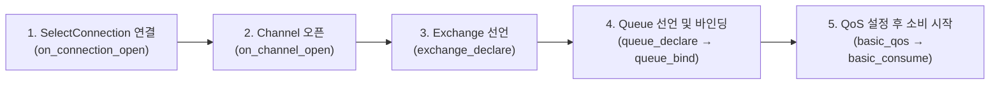

# Pika (Python RabbitMQ / AMQP 0-9-1 클라이언트)

**Pika**는 RabbitMQ에서 가장 널리 쓰이는 순수 Python 기반 **AMQP 0-9-1 프로토콜 클라이언트 라이브러리**다. 사용 환경에 따라 동기식 어댑터(`BlockingConnection`)와 비동기 이벤트 루프 어댑터(`SelectConnection`, `AsyncioConnection`)를 모두 제공한다.

---

## 1. 연결 어댑터 비교: `BlockingConnection` vs `SelectConnection`

| 구분 | `BlockingConnection` (동기식) | `SelectConnection` / `AsyncioConnection` (비동기식) |
| :--- | :--- | :--- |
| **동작 방식** | AMQP의 비동기 RPC 프레임 위에 블로킹 래퍼를 씌워 메서드 호출이 응답까지 대기 | I/O 이벤트 루프와 콜백(Continuation-Passing Style)으로 논블로킹 처리 |
| **구현 난이도** | 낮음 (직관적인 순차 코드) | 높음 (연결→채널→교환기→큐→바인딩→소비를 콜백 체인으로 구현) |
| **주 용도** | 단순 배치 발행자(Publisher), 간단한 워커 스크립트 | 고성능 장기 실행 컨슈머, 자동 재연결(Reconnection) 제어가 필요한 데몬 |

> [!WARNING]
> Pika의 모든 연결(`Connection`)과 채널(`Channel`) 인스턴스는 **스레드 안전(Thread-safe)하지 않다.** 멀티스레드 환경에서는 스레드마다 별도의 연결을 맺거나 스레드 전용 큐를 통해 단일 I/O 스레드가 발행하도록 구성해야 한다.

---

## 2. `BlockingConnection` 기본 사용법 (동기 발행 및 소비)

### 1) 메시지 발행 (Publisher)

```python
import pika

credentials = pika.PlainCredentials("guest", "guest")
params = pika.ConnectionParameters(
    host="localhost",
    port=5672,
    virtual_host="/",
    credentials=credentials,
    heartbeat=60,
    blocked_connection_timeout=300,
)

with pika.BlockingConnection(params) as connection:
    channel = connection.channel()
    # 브로커에 메시지 전달 보장을 위한 Publisher Confirms 활성화
    channel.confirm_delivery()
    channel.queue_declare(queue="task_queue", durable=True)

    channel.basic_publish(
        exchange="",
        routing_key="task_queue",
        body=b"Hello RabbitMQ!",
        properties=pika.BasicProperties(
            delivery_mode=pika.DeliveryMode.Persistent,  # 디스크 영속화
        ),
        mandatory=True,
    )
```

### 2) 메시지 소비 (Consumer & Manual Ack)

```python
import pika


def on_message(ch, method, properties, body):
    print(f"수신 메시지: {body.decode('utf-8')}")
    # 처리 완료 후 수동 ACK 전송 (프로세스 비정상 종료 시 메시지 유실 방지)
    ch.basic_ack(delivery_tag=method.delivery_tag)


with pika.BlockingConnection(pika.ConnectionParameters("localhost")) as connection:
    channel = connection.channel()
    channel.queue_declare(queue="task_queue", durable=True)
    # 워커가 한 번에 1개씩만 가져오도록 Prefetch 제한 (공평한 부하 분산)
    channel.basic_qos(prefetch_count=1)
    channel.basic_consume(queue="task_queue", on_message_callback=on_message)

    print("메시지 대기 중... (종료: Ctrl+C)")
    channel.start_consuming()
```

---

## 3. 비동기 컨슈머(`SelectConnection`)의 콜백 생명주기와 자동 재연결

장기 실행되는 운영 컨슈머에서 브로커 재시작이나 네트워크 순단에 대응하려면 `SelectConnection` 기반의 콜백 체인과 재연결 래퍼(`ReconnectingExampleConsumer`) 패턴을 사용한다.



### 핵심 구현 포인트

1. **콜백 체인(Continuation-Passing Style)**: 비동기 어댑터에서는 `channel.exchange_declare(..., callback=self.on_exchange_declareok)`처럼 앞 단계의 브로커 응답(`DeclareOk`)을 받은 콜백 안에서 다음 단계(`queue_declare` → `queue_bind` → `basic_qos` → `basic_consume`)를 호출한다.
2. **TCP 배압(Backpressure) 및 하트비트 관리**: 브로커의 메모리/디스크 알람으로 연결이 차단(`Connection.Blocked`)될 때를 대비해 `blocked_connection_timeout`과 `heartbeat`를 명시하고, 연결 종료 콜백(`on_connection_closed`)에서 일정 지연(`ioloop.call_later(5, self.stop)`) 후 새 연결 객체로 재기동하도록 작성한다.

---

## 4. 관련 문서

* [AMQP (Advanced Message Queuing Protocol)](../../../Infrastructure/MessageBroker/AMQP.md)
* [RabbitMQ vs Kafka 비교](../../../Infrastructure/MessageBroker/RabbitMQ%20그리고%20Kafka.md)
